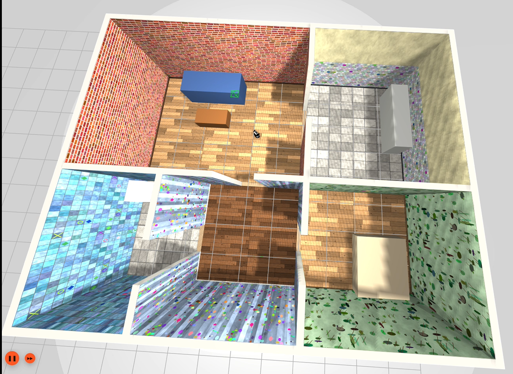

# robot_ros_slam

This project aims to build a simple robot using ROS 2 with Simultaneous Localization and Mapping (SLAM) capability. The main goal is to bring up a robot, integrate its sensor data, and use SLAM to create a map while estimating the robot's position.

Today the project simulates a small two-wheeled robot with a stereo camera
(`stereo_eye`) driving around an apartment in Gazebo Fortress, and builds a map
with RTAB-Map stereo SLAM on ROS 2 Humble. With `explore:=true` the robot also
drives itself: a frontier explorer picks unexplored edges of the map and Nav2
follows a path to them. The default explorer is explore_lite; pass
`explorer:=own` to use our own `frontier_explorer` node instead. How that
stack is wired, and which file and parameter control planning and navigation,
is in [documents/stereo_architecture.md](documents/stereo_architecture.md).

## Current status

**What works.** The robot maps the apartment and, after the tf2 upgrade
described below, drives autonomously with
`explore:=true`. The default explorer is explore_lite; `explorer:=own` starts
our own frontier_explorer instead. Completed maps are written under
`src/stereo_eye_launcher/maps/`. Each `run_sim.sh` run is also saved as
`logs/latest.log` (the previous run is kept as `logs/previous.log`).

**Known issues.**

- Humble **tf2 0.25.23** has a deadlock (ros2/geometry2 #990, fixed in 0.25.24)
  that freezes Nav2's position tracking: the planner may still print a path,
  but the robot never drives. The Dockerfile upgrades tf2 on a container
  rebuild. In an already-built container, run
  `sudo apt update && sudo apt install --only-upgrade 'ros-humble-tf2*'`
  and check that `dpkg -l ros-humble-tf2` shows **0.25.24 or later**.
  `run_sim.sh` warns if it still finds 0.25.23.
- The robot can still **get stuck mid-navigation** sometimes (a plan is
  visible, but it does not move). That is being investigated.
- Stock **explore_lite can stop at a doorway** (its frontier search will not
  spread through inflated cells). The workaround is `explorer:=own`. The bed
  is a solid 0.5 m-tall box, so it maps as a wall; that is kept as it is for
  now.

**Roadmap.** The current goal is reliable autonomous exploration of this
apartment, including getting unstuck. Speeding up mapping (around 10 minutes
for this apartment today) is a planned performance goal and will be done on
a separate branch. After the current goal, a learned local navigation policy
(Stable-Baselines3, trained in Gazebo, ToF + stereo depth → `/cmd_vel`) would
replace only Nav2's controller. The planner, the frontier explorer and the
ToF safety stop would stay. Those next pieces have not started yet. Details
are in the [architecture document](documents/stereo_architecture.md#10-current-state-known-issues-and-roadmap).

## Packages

| Package | What it is | Owner | Docs |
|---|---|---|---|
| `src/stereo_eye` | Robot description (URDF/xacro): body, wheels, stereo cameras, IMU, Gazebo plugins | MechaX (robot design) | [README](src/stereo_eye/README.md) |
| `src/apartment_gazebo` | Gazebo world: the apartment, its models and system plugins | Isekai (world design) | [README](src/apartment_gazebo/README.md) |
| `src/stereo_eye_launcher` | Launch package: Gazebo, bridge, stereo odometry, RTAB-Map, Nav2, explore_lite or frontier_explorer, RViz, driving, helper scripts, log script | Bazooka (launch files) | [README](src/stereo_eye_launcher/README.md) |
| `src/third_party/m-explore-ros2` | Git submodule: `explore_lite` (frontier exploration) and `explore_lite_msgs`, pinned at commit `326cf8a` | upstream, pinned here | [README](src/third_party/m-explore-ros2/README.md) |
| `src/camera_brightness` | Small node that reports the left camera image brightness | Kunal | none yet |
| `.devcontainer/` | Docker development container with ROS 2 Humble and all dependencies | Robocop (CTO) | [setup notes](documents/ROS_Docker_Container_Setup.md) |
| `documents/` | Stereo Eye documentation, including the system architecture | Robocop | [stereo_architecture.md](documents/stereo_architecture.md) |

## Quick start

Work inside the **ROS 2 Humble dev container** (`.devcontainer/`). On Windows
this is Docker Desktop with WSLg. The repository root is mounted as the
workspace `/workspaces/ros2-dev`.

First time only, on Windows in the repo folder, download the
`m-explore-ros2` submodule (frontier exploration source). Do this on the
host: git inside the container may be blocked by the work network.

```bash
git submodule update --init
```

Then, inside the container:

```bash
cd /workspaces/ros2-dev
git pull
colcon build --packages-up-to stereo_eye_launcher
source install/setup.bash
./src/stereo_eye_launcher/scripts/run_sim.sh explore:=true gz_gui:=false
```

`explore:=true` starts Nav2 and a frontier explorer (explore_lite by default; add `explorer:=own` for frontier_explorer), so the robot drives itself.
`gz_gui:=false` starts only the Gazebo server (no Gazebo window). That avoids
the WSL GPU running out of memory and taking the whole launch down. RViz still
opens and shows the robot, the cameras and the map.

To look at Gazebo as well, attach a GUI from a **second** terminal while the
server is running:

```bash
ign gazebo -g
```

If that window later crashes, close it; the server and the rest of the launch
should keep running.

Without `explore:=true`, Gazebo, RViz and a Robot Steering window open and
you drive with the sliders (keep about 0.15 m/s and 0.4 rad/s).

Output is printed in the terminal and also saved as plain text to
`logs/latest.log` at the repo root (`/workspaces/ros2-dev/logs/latest.log`
in the container). The previous run is kept as `logs/previous.log`.

The [launcher README](src/stereo_eye_launcher/README.md) explains every
launch argument, the TF tree, driving, exploration and troubleshooting.
The [architecture document](documents/stereo_architecture.md) explains the node
graph and how to tune planning and navigation.

See [documents/ROS_Build_Guide.md](documents/ROS_Build_Guide.md) for the repository's package/build overview and [documents/ROS_Setup_Cariad.md](documents/ROS_Setup_Cariad.md) for the ROS 2 Humble development environment setup.

## Demo
Following video captured with 4x (original took 12 min for shown map) Speed and robot is moving autonomously with some limitation as get stuck sometimes deciding on which direction to move and currently not perfect navigating but creates 2D map as shown using RTAB SLAM

<table>
  <tr>
    <td width="50%">
      
      <br><b>Apartment World Gazebo</b>
    </td>
    <td width="50%">
      <video src="documents/videos/rviz_02.mp4" controls width="100%"></video>
      <br><b>Stereo Eye SLAM Rviz</b>
    </td>
  </tr>
</table>
