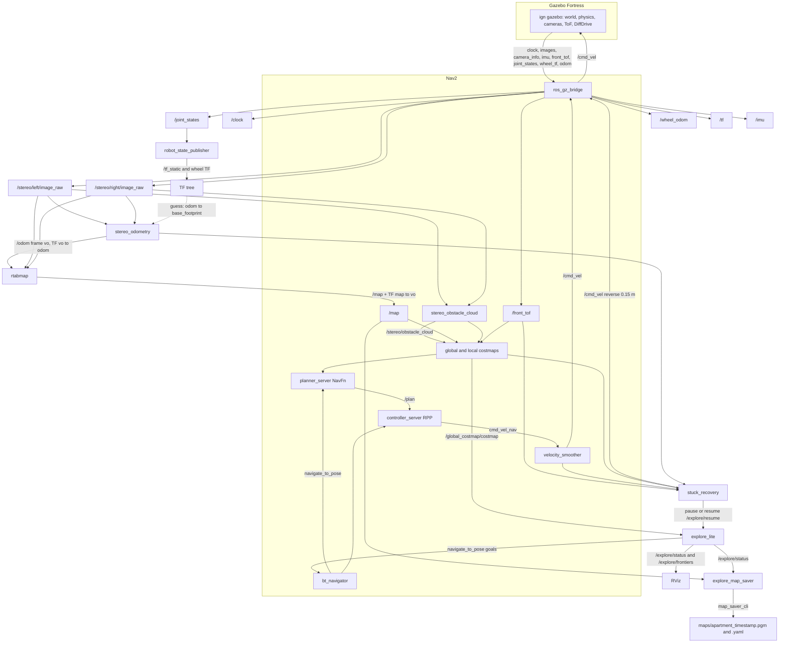
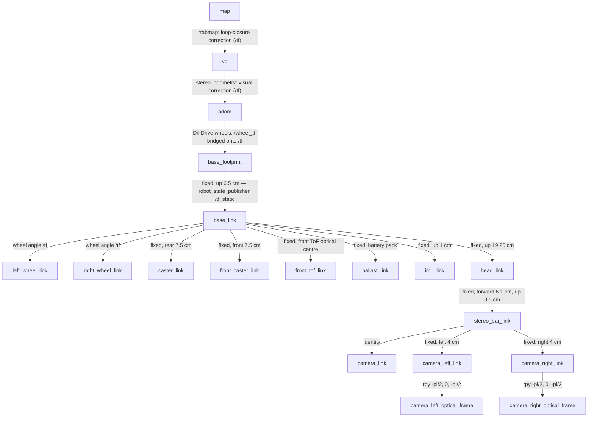

# System architecture

This document describes how the `robot_ros_slam` project is put together, and
how you can change the way the robot navigates and plans. It is written for a
ROS beginner: every idea used here is introduced once, then used with the
**real topic names, file paths and parameter values** from this repository.
Nothing here is invented; if a number appears, it comes from a file in the
repo.

If you only want to start the simulation, see the [root README](../README.md)
and the [launcher README](../src/stereo_eye_launcher/README.md). This file
explains *how it works* and *which knob does what*.

---

## 1. What this project does

The project simulates a small two-wheeled robot called **stereo_eye** inside a
10 m × 8 m apartment in **Gazebo Fortress** (the Gazebo version that ships
with ROS 2 Humble). The robot has:

- a **stereo camera** (two 640×360 cameras, 80 mm apart, 24 fps) used to
  estimate motion and to build a map
- a short-range **time-of-flight (ToF)** ranger on the nose (0.01–0.30 m)
- two drive wheels and two caster balls
- an IMU (published, but not used by SLAM or Nav2 in the current launch)

While it drives, **RTAB-Map** builds a 2D occupancy map from the stereo
cameras. With `explore:=true`, **explore_lite** picks unexplored edges of that
map (frontiers) and **Nav2** plans a path and drives there, slowly, until the
apartment is mapped. The map is then saved as a `.pgm` picture plus a `.yaml`
file.

The stack is:

> Gazebo → `ros_gz_bridge` → RTAB-Map stereo odometry + SLAM
> → Nav2 (planner + controller) → explore_lite, plus two helper nodes
> (`stuck_recovery.py` and `explore_map_saver.py`).

Everything is started by `src/stereo_eye_launcher/scripts/run_sim.sh`.

---

## 2. ROS 2 ideas used in this project

You can skip this section if you already know ROS 2. Every later section
assumes these words.

**Node.** A running program. Examples here: `stereo_odometry`, `rtabmap`,
`controller_server`, `explore_node`. Several nodes can run at once and talk
to each other.

**Topic.** A named stream of messages. A node **publishes** (writes) or
**subscribes** (reads). Example: the cameras publish images on
`/stereo/left/image_raw` and `/stereo/right/image_raw`. Topic names in this
doc start with `/` when they are the actual names on the ROS graph.

**Message type.** The layout of a topic, for example `sensor_msgs/msg/Image`
or `geometry_msgs/msg/Twist`. Both sides of a topic must use the same type.

**QoS (Quality of Service).** Extra rules about how messages are delivered.
The important one here is **transient local** (also called "latched"): the
last message is kept, so a node that starts late still receives it. rtabmap
publishes `/map` this way, and explore_lite publishes `/explore/status` this
way.

**Service.** A request/response call, used occasionally (for example
"clear the costmap"). Not used for the continuous data flow.

**Action.** A long-running goal that can succeed, fail, or be replaced.
explore_lite sends each frontier to Nav2 as a `nav2_msgs/action/NavigateToPose`
goal on the action server `navigate_to_pose`.

**Parameter.** A named setting of a node, often loaded from a YAML file.
Changing a parameter is how you tune navigation without rewriting code.
After you edit a YAML file you must rebuild (or at least re-install) the
package and restart the launch; running nodes do not re-read the file by
themselves.

**Launch file.** A Python file that starts a whole set of nodes and
passes them their parameters. Ours is
`src/stereo_eye_launcher/launch/launch.py`. You start it with
`ros2 launch` or, more conveniently, with `run_sim.sh`.

**Launch argument.** A switch you pass on the command line, for example
`explore:=true` or `gz_gui:=false`. These are declared at the top of
`launch.py`.

**Frames and TF.** A **frame** is a coordinate system attached to a part of
the robot or the world (`base_footprint`, `map`, `camera_left_optical_frame`,
…). **TF** (the `tf2` library) stores the position and orientation of every
frame relative to its parent. The frames form a **tree**: each frame has
exactly one parent. Almost every node in this project asks TF "where is
frame A relative to frame B?". The tree used here is described in
[section 7](#7-the-tf-tree).

**Sim time.** Gazebo publishes a simulation clock on `/clock`. Every node is
started with `use_sim_time:=true`, so they all use that clock, not the wall
clock. If the simulation runs slower than real time, the robot's "seconds"
slow down with it. That is expected.

**Costmap.** A 2D grid Nav2 uses for planning and collision checking. Each
cell is free, occupied, unknown, or a cost in between (a "keep away from the
wall" value). This project has two: a **global costmap** in the `map` frame
(the whole known map) and a **local costmap** in the `odom` frame (a 3 m × 3 m
window that moves with the robot).

**Behaviour tree (BT).** The program Nav2 follows for one `navigate_to_pose`
goal: plan a path, follow it, and if that fails, try a short recovery and
plan again. Ours is
`src/stereo_eye_launcher/behavior_trees/explore_navigate_to_pose.xml`.

---

## 3. Packages and who owns them

The repository root is the ROS 2 workspace (inside the dev container that
path is `/workspaces/ros2-dev`). Packages live under `src/`. Bots commit
only in the paths they own.

| Path | What it is | Owner |
|---|---|---|
| `src/stereo_eye` | Robot model only: URDF/xacro, visuals, collisions, Gazebo camera / IMU / ToF / DiffDrive plugins | MechaX |
| `src/apartment_gazebo` | The apartment world: walls, furniture, textures, lighting, sensor system plugins | Isekai |
| `src/stereo_eye_launcher` | Launch file, Nav2 and explore_lite parameters, behaviour tree, RViz config, `run_sim.sh`, `stuck_recovery.py`, `explore_map_saver.py` | Bazooka |
| `src/third_party/m-explore-ros2` | Git submodule (commit `326cf8a`). Provides the `explore_lite` and `explore_lite_msgs` packages. `colcon_defaults.yaml` skips the unused `multirobot_map_merge` package | upstream, pinned in this repo |
| `src/camera_brightness` | Small node that publishes the mean brightness of the left camera image | Kunal |
| `.devcontainer/` | Docker image: ROS 2 Humble, Gazebo Fortress (`ros-humble-ros-gz`), RTAB-Map, Nav2, RViz, and a tf2 upgrade past 0.25.23 | Robocop |
| `documents/` | Project documentation, including this file | Robocop |
| `battery_node_demo/` | A practice project for learning ROS 2, not part of the robot | Kunal |

Related docs for the pieces:

- Robot design: [src/stereo_eye/README.md](../src/stereo_eye/README.md)
- Apartment world: [src/apartment_gazebo/README.md](../src/apartment_gazebo/README.md)
- Launch, driving, troubleshooting: [src/stereo_eye_launcher/README.md](../src/stereo_eye_launcher/README.md)

---

## 4. The robot and the apartment

### Robot (`stereo_eye`)

Numbers are from `src/stereo_eye/urdf/stereo_eye.urdf.xacro` and
`src/stereo_eye/README.md`.

| Quantity | Value |
|---|---|
| Width (widest part: head with ear caps) | 0.256 m (0.128 m either side of the centre) |
| Length (ToF front to rear caster) | 0.213 m (front +0.116 m, back −0.097 m) |
| Nav2 circle (`robot_radius`) | 0.15 m (real half-width 0.128 m + 0.022 m) |
| Wheel radius / separation | 0.065 m / 0.190 m |
| Mass | 4.08 kg |
| Stereo baseline | 0.080 m |
| Camera resolution / rate / horizontal FOV | 640×360, 24 fps, 1.5 rad (~86°) |
| Focal length `fx` (square pixels) | about 343.5 px |
| ToF range / rate / field of view | 0.01–0.30 m, 20 Hz, 11×3 rays over 25° horizontal and ±1° vertical, 5.5 cm above the floor |
| DiffDrive command limits (Gazebo plugin) | ±0.3 m/s, ±1.0 rad/s, ±0.5 m/s², ±1.5 rad/s² |
| Speeds used for driving and Nav2 | 0.15 m/s and 0.4 rad/s (well below the plugin limits, so visual odometry can keep up) |

The launch builds the robot with
`xacro stereo_eye.urdf.xacro use_gazebo:=true`, which also pulls in
`stereo_eye.gazebo.xacro` (the Gazebo sensors and the DiffDrive plugin).

The robot is spawned in the living room at **x = 4.00 m, y = 5.50 m,
z = 0.05 m, yaw = 0** (facing +X, toward the kitchen opening).

### Apartment (`apartment_gazebo`)

A closed 10 m × 8 m indoor world (`worlds/apartment.sdf`). Walls are 0.15 m
thick and 2.5 m tall. Interior doorways are empty gaps:

| Opening | Clear width |
|---|---|
| Living room ↔ hallway | 1.00 m |
| Living room ↔ kitchen | 1.60 m |
| Hallway ↔ bedroom | 1.00 m |
| Hallway ↔ bathroom | 0.90 m |

Those openings are much wider than the robot. Nav2 is still tuned so a
**tighter** gap of body width + 10 cm (0.356 m, 5 cm per side) stays
passable; that is a design target, not the width of these apartment doors.
Rooms have textured walls, floors and posters so the stereo cameras have
features to track.

---

## 5. How the pieces start (launch)

### The usual command

Inside the dev container:

```bash
cd /workspaces/ros2-dev
colcon build --packages-up-to stereo_eye_launcher
source install/setup.bash
./src/stereo_eye_launcher/scripts/run_sim.sh explore:=true gz_gui:=false
```

`run_sim.sh` sources the workspace, warns if tf2 is the broken 0.25.23
version, starts `ros2 launch stereo_eye_launcher launch.py` with your
arguments, prints everything in the terminal (with colours), and also
saves a plain-text copy to:

```
/workspaces/ros2-dev/logs/latest.log      this run
/workspaces/ros2-dev/logs/previous.log    the run before
```

The `logs/` folder is gitignored. Starting with plain `ros2 launch` does
**not** save a log file.

### Launch arguments

Declared in `src/stereo_eye_launcher/launch/launch.py`:

| Argument | Default | Meaning |
|---|---|---|
| `use_sim_time` | `true` | Nodes use Gazebo's `/clock` |
| `world` | `apartment_gazebo` `worlds/apartment.sdf` | World file |
| `x` `y` `z` `yaw` | `4.00` `5.50` `0.05` `0.0` | Spawn pose |
| `rviz` | `true` | Start RViz with `rviz/stereo_slam.rviz` |
| `steering` | `true` | Start `rqt_robot_steering` (ignored when `explore:=true`) |
| `teleop` | `false` | Start `teleop_twist_keyboard` in an xterm (also ignored when exploring) |
| `render_engine` | `ogre` | Gazebo render engine (`ogre` or `ogre2`). `ogre` is required on WSL D3D12; `ogre2` crashes there |
| `gz_gui` | `true` | Open the Gazebo window. `false` starts only the server (`-s`) |
| `explore` | `false` | Start Nav2, explore_lite, the live obstacle cloud, stuck recovery and the map saver. Turns steering and teleop off |
| `maps_dir` | `/workspaces/ros2-dev/src/stereo_eye_launcher/maps` | Where completed maps are written |
| `map_name` | `apartment` | File-name prefix of the saved map |

### Seeing Gazebo while the GUI is off

`gz_gui:=false` is the recommended way to run on Windows / WSL: the Gazebo
window shares a small amount of GPU memory with the camera sensors, and when
it runs out (`D3D12: Removing Device`) the whole launch dies, because
Gazebo is started with `on_exit_shutdown:=true`.

With the server already running you can attach a GUI from a **second**
terminal, without putting the GUI in the same process as the server:

```bash
ign gazebo -g
```

If that window later crashes or you close it, the server (and therefore the
launch, RViz and the robot) should keep running. Attaching the GUI uses GPU
memory again, so if the crash comes back, close the GUI and keep using RViz.

### What `launch.py` starts, in order of dependence

The launch file starts these nodes together (they wait for each other's
topics). Conceptually the chain is:

1. Set `IGN_GAZEBO_RESOURCE_PATH`, `GZ_SIM_RESOURCE_PATH` and
   `GAZEBO_MODEL_PATH` so the world's `model://` furniture resolves.
2. **Gazebo** (`ign gazebo -r -v 1 --render-engine ogre <world>`, plus `-s`
   when `gz_gui:=false`).
3. **robot_state_publisher** — publishes the robot's fixed frames and, once
   `/joint_states` arrives, the moving wheel frames.
4. **spawn** (`ros_gz_sim create`) — inserts the robot into the world as
   entity `stereo_eye`.
5. **ros_gz_bridge** — copies these topics between Gazebo and ROS:

   | ROS topic | Direction | Notes |
   |---|---|---|
   | `/clock` | Gazebo → ROS | Simulation time |
   | `/stereo/left/image_raw`, `/stereo/left/camera_info` | Gazebo → ROS | Left camera |
   | `/stereo/right/image_raw`, `/stereo/right/camera_info` | Gazebo → ROS | Right camera |
   | `/imu` | Gazebo → ROS | Not consumed by SLAM or Nav2 |
   | `/wheel_odom` | Gazebo → ROS | DiffDrive `/odom`, remapped so it does not collide with visual odometry |
   | `/tf` | Gazebo → ROS | DiffDrive `/wheel_tf` (`odom` → `base_footprint`) |
   | `/joint_states` | Gazebo → ROS | Wheel angles |
   | `/cmd_vel` | ROS → Gazebo | Wheel commands |
   | `/front_tof` | Gazebo → ROS | `sensor_msgs/LaserScan`, 0.30 m ToF |

6. **stereo_odometry** (`rtabmap_odom`) and **rtabmap** (`rtabmap_slam`).
   Images are already distortion-free, so `left/image_rect` and
   `right/image_rect` are remapped onto the raw image topics. Approximate
   sync is on (`approx_sync` true, 20 ms). rtabmap is started with `-d`, so
   every launch begins with a fresh map database.
7. **camera_brightness** — remapped from `/image` to `/stereo/left/image_raw`.
8. **RViz**, and (only if `explore` is false) **rqt_robot_steering** and
   optionally **teleop_twist_keyboard**.
9. If `explore:=true` only:
   - **Nav2** via `nav2_bringup/launch/navigation_launch.py`
     (controller, planner, behaviour server, bt_navigator, velocity
     smoother, …). There is **no** AMCL and **no** map_server: rtabmap
     already provides `/map` and `map` → `vo`.
   - **stereo_obstacle_cloud** (`rtabmap_util point_cloud_xyzrgb`) publishes
     `/stereo/obstacle_cloud`.
   - **explore_lite** (`explore` executable, node name `explore_node`).
   - **stuck_recovery.py**.
   - **explore_map_saver.py**.

The behaviour-tree path cannot be hard-coded in the YAML (it depends on the
install prefix), so `launch.py` uses Nav2's `RewrittenYaml` to put the
installed path of `explore_navigate_to_pose.xml` into
`default_nav_to_pose_bt_xml`.

---

## 6. The node and topic graph

This is the graph with `explore:=true`. Manual steering uses the same
`/cmd_vel` topic, but Nav2, explore_lite, the obstacle cloud, stuck
recovery and the map saver are then absent.



A few details the diagram hides:

- `/cmd_vel` has several writers, but not at the same time: Nav2's velocity
  smoother during normal driving, `stuck_recovery.py` during a backup,
  `explore_map_saver.py` during a start-up look-around turn, and
  `rqt_robot_steering` / teleop only when `explore` is false.
- The IMU is bridged and then unused.
- `camera_brightness` reads `/stereo/left/image_raw` and publishes a string
  on `camera_brightness`. It is not on the navigation path.

---

## 7. The TF tree

Every frame has exactly one parent. The moving part of the tree is:

```text
map → vo → odom → base_footprint → (the robot)
```



Who publishes which link:

| Transform | Publisher | Topic |
|---|---|---|
| `map` → `vo` | rtabmap | `/tf` |
| `vo` → `odom` | stereo_odometry | `/tf` |
| `odom` → `base_footprint` | Gazebo DiffDrive | `/wheel_tf` → bridged to `/tf` |
| `base_footprint` → fixed robot parts | robot_state_publisher | `/tf_static` |
| `base_link` → wheels | robot_state_publisher | `/tf`, from `/joint_states` |

Why three layers above the robot? Wheel odometry (`odom`) is smooth and never
"gets lost", but it drifts (especially when turning). Visual odometry (`vo`)
corrects that from the cameras, but can get lost on a plain wall or a fast
turn. `map` is the globally consistent frame: when rtabmap recognises a
place it has seen before (a loop closure), it shifts `vo` and the map stays
lined up. stereo_odometry uses the wheel transform as a **guess**
(`guess_frame_id: odom`) and only publishes the visual correction
(`odom_frame_id: vo`), so `base_footprint` never has two parents.

To inspect the tree yourself:

```bash
ros2 run tf2_ros tf2_echo map base_footprint
ros2 run tf2_tools view_frames
```

---

## 8. Data flow: from sensors to wheels

This is the path a camera frame takes until the wheels turn, when
`explore:=true`.

1. **Cameras and ToF render in Gazebo.** Both cameras share the same update
   rate (24 fps) so they are meant to share a timestamp. Under load the
   stamps can drift by a few milliseconds; approximate sync (20 ms) still
   pairs them.

2. **The bridge** copies images, camera info, `/front_tof`, wheel TF,
   `/wheel_odom` and `/joint_states` into ROS, and copies `/cmd_vel` back.

3. **stereo_odometry** matches features (GFTT corners, ORB descriptors, up
   to 1000 per frame, Frame-to-Map) between stereo frames, starting from the
   wheel motion. It publishes:
   - `/odom` (frame `vo`): the visual pose, used by rtabmap and by
     `stuck_recovery.py`
   - TF `vo` → `odom`
   If tracking is lost (`quality=0`), `Odom/ResetCountdown: 1` resets it on
   the next frame from the latest pose plus the wheel motion.
   `publish_null_when_lost` is `false`, so rtabmap keeps **one** map across
   a reset instead of starting a new, disconnected session.

4. **rtabmap** builds a 2D occupancy grid on `/map` from stereo depth:
   - `Grid/CellSize` 0.025 m (same as the Nav2 costmaps)
   - `Grid/RangeMax` 4.0 m, `Grid/RayTracing` true (cells between the
     camera and a hit become free, which frontiers need)
   - floor: points up to 5 cm (`Grid/MaxGroundHeight`)
   - obstacles: 5 cm to 40 cm (`Grid/MaxObstacleHeight`)
   - `Reg/Force3DoF` true: only x, y, yaw, so the map stays flat
   - a new map node every 5 cm or 0.05 rad (`RGBD/LinearUpdate`,
     `RGBD/AngularUpdate`)
   It also publishes TF `map` → `vo`.

5. **stereo_obstacle_cloud** computes a live point cloud
   (`/stereo/obstacle_cloud`) with OpenCV block matching
   (`StereoBM/NumDisparities` 128). Closest measurable depth is
   `fx * baseline / 128 ≈ 343.5 * 0.08 / 128 ≈ 0.21 m`; on plain walls it
   often fails closer than about **0.35 m**. That band is the **stereo
   blind zone**. The cloud is decimated, voxel-filtered (5 cm) and
   noise-filtered, and points further than 3 m are dropped.

6. **Costmaps** combine three things:
   - rtabmap's `/map` (static layer)
   - the live stereo cloud (obstacle layer; marks 10–40 cm above the floor,
     up to 2.5 m)
   - on the **local** costmap only, `/front_tof` (0.025–0.30 m), which
     covers the blind zone straight ahead
   Then the inflation layer paints a soft safety margin around obstacles
   (see [section 9.3](#93-costmaps-robot-radius-and-inflation)).

7. **explore_lite** looks at `/global_costmap/costmap` (not `/map` directly:
   rtabmap only republishes `/map` when it changes, and explore_lite
   does not use transient-local QoS). Every 10 s it scores frontiers and
   sends the best centroid as a `navigate_to_pose` goal.

8. **bt_navigator** runs `explore_navigate_to_pose.xml`. If the goal is
   already within 0.35 m it **fails** at once (so explore_lite blacklists
   it, instead of succeeding forever on a frontier the cameras cannot see).
   Otherwise it asks the planner for a path, then the controller to follow
   it. Recoveries are only "clear costmaps" and "wait 2 s", up to 4
   retries. There is no Spin and no BackUp in this tree.

9. **planner_server (NavFn, Dijkstra)** plans on the global costmap to a
   cell within 0.3 m of the goal (`tolerance: 0.3`). Unknown cells are
   allowed (`allow_unknown: true`). The path is published on `/plan`.

10. **controller_server (Regulated Pure Pursuit, id `FollowPath`)** follows
    that path at up to 0.15 m/s, turning in place only if the carrot is
    more than 60° off, looking 0.45 m ahead, never reversing
    (`allow_reversing: false`). It uses the **local** costmap to stop if a
    collision is 1.0 s ahead.

11. **velocity_smoother** limits the command to ±0.15 m/s and ±0.4 rad/s
    and publishes `/cmd_vel`. `navigation_launch.py` remaps the smoother's
    output onto `/cmd_vel`.

12. **The bridge** forwards `/cmd_vel` to the Gazebo DiffDrive, and the
    wheels turn.

If something is too close or the robot cannot plan, **stuck_recovery.py**
interrupts this chain: it is the **only** thing that drives the robot
backwards.

---

## 9. How to control navigation and planning

Edit the file named below, then rebuild (or reinstall) `stereo_eye_launcher`
and restart the launch. Change only what you need; each row lists what
happens if you raise or lower the value.

### 9.1 Planner

File: `src/stereo_eye_launcher/config/nav2_params.yaml`, section
`planner_server` / `GridBased` (`nav2_navfn_planner/NavfnPlanner`).
The behaviour tree calls planner id `GridBased`.

| Parameter | Current | If you raise it | If you lower it |
|---|---|---|---|
| `tolerance` | 0.3 m | Plans to a cell further from a bad frontier centroid (can send the robot closer to a wall) | Goals that sit just inside a wall fail sooner and get blacklisted |
| `use_astar` | `false` (Dijkstra) | `true` is usually faster but can give slightly different paths | — |
| `allow_unknown` | `true` | — | `false` forbids paths through unknown cells; exploration of new rooms becomes harder |
| `expected_planner_frequency` | 1.0 Hz | Only a warning threshold; the BT already replans at 1 Hz | — |

The planner will not start from a cell whose cost is inscribed (253) or
lethal (254). If the robot's centre is within `robot_radius` (0.15 m) of a
wall, every plan fails. That is what stuck_recovery's `[NO PATH]` trigger
is for.

### 9.2 Controller (speeds and lookahead)

File: the same `nav2_params.yaml`, sections `controller_server` /
`FollowPath` (`RegulatedPurePursuitController`) and `velocity_smoother`.

The smoother is the last limit before the wheels. Raising RPP's
`desired_linear_vel` above 0.15 m/s does nothing unless you also raise
`velocity_smoother.max_velocity`. Keep speeds modest: faster turns are the
usual reason visual odometry gets lost. The Gazebo plugin will still cap
commands at 0.3 m/s and 1.0 rad/s.

| Parameter | Current | If you raise it | If you lower it |
|---|---|---|---|
| `desired_linear_vel` | 0.15 m/s | Faster straight driving (if the smoother allows it); odometry is more likely to get lost | More cautious, slower mapping |
| `lookahead_dist` | 0.45 m | Smoother, fewer stop-and-turn decisions; more likely to cut a corner | Tracks the path more tightly, more turning in place |
| `min_lookahead_dist` | 0.3 m | Same as above, when close to the goal | — |
| `min_approach_linear_velocity` | 0.08 m/s | Less creeping at the goal; can overshoot slightly | More hesitation on the last centimetres |
| `approach_velocity_scaling_dist` | 0.3 m | Starts slowing earlier | Starts slowing later, more decisive at the end |
| `cost_scaling_dist` | 0.25 m | Slows down further from obstacles (more timid in open rooms) | Only slows when already close (current intent) |
| `regulated_linear_scaling_min_speed` | 0.08 m/s | Stays faster near obstacles and on curves | Can crawl; below this, stuck_recovery's "pushing" check may never fire |
| `rotate_to_heading_min_angle` | 1.05 rad (60°) | Turns in place only for sharper corners; drives more arcs (can swing the body toward a wall) | Turns in place more often (looks like dithering) |
| `rotate_to_heading_angular_vel` | 0.4 rad/s | Faster in-place turns; harder on visual odometry | Slower turns |
| `allow_reversing` | `false` | Do **not** turn this on while `use_rotate_to_heading` is true; reversing is left to stuck_recovery | — |
| `max_allowed_time_to_collision_up_to_carrot` | 1.0 s | Stops earlier for far-away (sometimes fake) stereo points | Reacts later; more likely to get close to a real wall |
| `progress_checker.required_movement_radius` | 0.10 m | Harder to abort a stalled goal | Gives up sooner |
| `progress_checker.movement_time_allowance` | 10.0 s | Waits longer when stuck in front of a gap | Aborts sooner; must stay long enough for a half-turn (`π / 0.4 ≈ 7.9` s) |
| `general_goal_checker.xy_goal_tolerance` | 0.30 m | Goals succeed further away; must stay **below** `goal_reached_tol` (0.35 m) | Creeps further into corners |
| `general_goal_checker.yaw_goal_tolerance` | 3.14 rad | — | A smaller value makes the robot spin to a heading at every frontier; explore_lite's orientation is not meaningful |
| `velocity_smoother.max_velocity` | `[0.15, 0.0, 0.4]` | Raises the hard cap on `/cmd_vel` | Lowers the hard cap |
| `velocity_smoother.max_accel` | `[0.5, 0.0, 1.5]` | Sharper speed changes (matches the DiffDrive limits already) | Gentler acceleration |

`controller_frequency` is 10 Hz, `smoothing_frequency` is 20 Hz,
`feedback` is `OPEN_LOOP`.

### 9.3 Costmaps: robot radius and inflation

File: `nav2_params.yaml`, `local_costmap` and `global_costmap`. Keep the two
costmaps and rtabmap's `Grid/CellSize` in `launch.py` at the **same**
resolution (0.025 m). Keep `FollowPath.inflation_cost_scaling_factor` equal
to `inflation_layer.cost_scaling_factor` (both 6.0).

The robot is treated as a circle of radius `robot_radius`. Cells closer
than that to an obstacle get cost **253** ("the circle would touch"), which
NavFn treats as a wall. Further out, cost falls off as

```text
cost = 252 * exp(-cost_scaling_factor * (distance - robot_radius))
```

and is 0 beyond `inflation_radius`. With the current 6.0 and 0.35 m, a
point in the middle of a 0.356 m gap (0.178 m to each side) has cost 213
and is therefore open; 3 cm off the middle is already 253 and blocked. So
the planner is forced through the middle of a tight gap, without forbidding
the gap.

| Parameter | Current | If you raise it | If you lower it |
|---|---|---|---|
| `robot_radius` (both costmaps) | 0.15 m | More clearance; tight gaps (and eventually some real doors, if you go too far) become impassable. 0.18 m already blocks a 0.356 m gap | Closer to walls and door frames; more bumping if the map is a few centimetres off |
| `resolution` (both) and rtabmap `Grid/CellSize` | 0.025 m | Coarser map, lighter CPU; a 0.356 m gap can look too narrow depending on cell alignment (this happened at 0.05 m) | Finer map, heavier CPU |
| `inflation_radius` | 0.35 m | The soft "prefer the middle" field reaches further into the room | The robot is only pushed off walls that are closer |
| `cost_scaling_factor` | 6.0 | Cost drops faster; narrower gaps look cheaper / more open | Cost stays high further out; more timid, paths hug the centre of rooms |
| local `width` / `height` | 3 m × 3 m | Sees further for local collision checks, more CPU | May miss an obstacle just outside the window |
| `track_unknown_space` (global) | `true` | — | Do not turn this off: frontiers need unknown cells to stay unknown |
| `always_send_full_costmap` (global) | `true` | — | Do not turn this off: explore_lite can miss the first map if it only gets updates |

### 9.4 Obstacle layers

File: `nav2_params.yaml` obstacle_layer, plus the cloud node in `launch.py`.

Local sources: `stereo_mark`, `stereo_clear`, `front_tof`.
Global sources: `stereo_mark`, `stereo_clear` only (no ToF — the planner
should not treat a 30 cm feeler as a long-range wall).

| Parameter | Current | If you raise it | If you lower it |
|---|---|---|---|
| stereo `min_obstacle_height` (mark) | 0.10 m | Ignores more of the lower band (can miss low furniture) | 0.05 m used to mark noisy floor points as fake obstacles and made the robot hesitate |
| stereo `max_obstacle_height` | 0.40 m | Marks taller things (table tops the robot can drive under) | May miss some obstacles |
| stereo `obstacle_max_range` | 2.5 m | Marks further away (noisier stereo depth) | Reacts later |
| ToF `obstacle_min_range` | 0.025 m | Ignores more of the nearest band (those hits already fall inside the 0.15 m footprint) | Can accept Gazebo clamp artefacts at `range_min` (0.01 m) as a fake wall |
| ToF `obstacle_max_range` | 0.30 m | ToF would need a matching change in the xacro (`tof_max_range`) | Re-opens part of the stereo blind zone |
| cloud `max_depth` (launch.py) | 3.0 m | Longer, noisier cloud | Shorter feeler |
| cloud `voxel_size` | 0.05 m | Sparser marks | Denser cloud, more CPU |
| cloud `noise_filter_min_neighbors` | 5 | Drops more isolated points (can also drop thin real objects) | More stereo speckles become obstacles |
| `StereoBM/NumDisparities` | 128 | Can measure closer (more CPU, more mismatches) | Closest depth gets even further than 0.21 m |

The stereo layer **keeps** marks until a clearing ray erases them, because
a wall that has entered the 0.35 m blind zone can no longer be seen by the
cameras. Local recoveries therefore use `ClearCostmapExceptRegion` with
`reset_distance` 1.5 m: obstacles in a 1.5 m × 1.5 m square around the
robot are **kept**. The global costmap is still cleared entirely (rtabmap's
`/map` is then layered back on).

### 9.5 explore_lite frontier parameters

File: `src/stereo_eye_launcher/config/explore_params.yaml`.
The node is started with that file when `explore:=true`.

This version (submodule `326cf8a`) ranks frontiers as:

```text
cost = potential_scale * distance_m * resolution  -  gain_scale * length_m
```

`distance_m` is the straight-line distance to the frontier's nearest cell;
`length_m` is the frontier size. The extra `* resolution` means that
halving the cell size also halves the weight of distance, which is why
`potential_scale` was raised to 10 after the switch to 2.5 cm cells.
`orientation_scale` is read but **not used** in this version, so you cannot
ask it to prefer frontiers ahead by changing a parameter.

A goal is the frontier **centroid**. If that centroid moves by more than
1 cm, explore_lite treats it as a new goal and re-sends it (which restarts
Nav2). There is no "keep the current goal" option; a lower
`planner_frequency` is the way to calm that down. A reached or failed goal
still triggers a new choice immediately.

| Parameter | Current | If you raise it | If you lower it |
|---|---|---|---|
| `planner_frequency` | 0.1 Hz (every 10 s) | Re-ranks more often; more goal flickering and Nav2 restarts | Sticks to a goal longer |
| `progress_timeout` | 30 s | Waits longer before blacklisting a frontier the robot is not approaching | Gives up sooner. Nav2's own progress checker (10 cm in 10 s) usually fires first |
| `potential_scale` | 10.0 | Stronger preference for near frontiers; finishes one area before crossing the apartment | More likely to chase a large frontier on the other side of the map |
| `gain_scale` | 1.0 | Prefers larger frontiers more | Prefers size less |
| `min_frontier_size` | 0.3 m | Ignores short, ragged edges (0.75 m was too strict: at start-up no frontier was long enough and exploration stopped at once) | Accepts smaller fragments; more noisy goals along walls, which then get blacklisted if Nav2 fails them |
| `transform_tolerance` | 0.5 s | More tolerant of a lagging TF | More "transform" errors when odometry is briefly late |
| `return_to_init` | `false` | `true` drives back to the start pose when exploration ends | — |
| `visualize` | `true` | — | Turns off `/explore/frontiers` markers in RViz |
| `costmap_topic` | `/global_costmap/costmap` | Do not point this at `/map` without also changing QoS: explore_lite can wait forever for the first latched map | — |

Blacklisting is hard-coded as "within 5 cells" (5 × 0.025 = 0.125 m).
Changing that needs a patch in the submodule, not a parameter.

### 9.6 Behaviour-tree recoveries

File: `src/stereo_eye_launcher/behavior_trees/explore_navigate_to_pose.xml`.
`bt_navigator.goal_reached_tol` (0.35 m) lives in `nav2_params.yaml`.

What the tree does:

1. `Inverter(GoalReached)` — if the robot is already within 0.35 m of the
   goal, the tree **fails** (ABORTED). explore_lite blacklists ABORTED
   goals. This check runs only once, when the goal arrives, so arriving at
   a real goal later still succeeds.
2. Replan at 1 Hz (`RateController hz="1.0"`) with NavFn (`GridBased`).
   If the plan fails, clear the **global** costmap and try once more.
3. Follow the path with RPP (`FollowPath`). If that fails, clear the
   **local** costmap except a 1.5 m region around the robot, and try once
   more.
4. If the whole navigate step fails, recoveries in a round-robin, at most
   **4** retries: (a) clear local-except-region + clear global, (b) wait
   2 s. Then the goal is ABORTED and explore_lite picks another frontier.

Spin and BackUp are **not** in this tree. They are still loaded in
`behavior_server` because Nav2's default `navigate_through_poses` tree
(loaded at start-up) refers to them; if those plugins were missing,
`bt_navigator` would fail to activate. Exploration never calls them.

| Knob | Current | Effect of changing it |
|---|---|---|
| `goal_reached_tol` | 0.35 m | Must stay larger than `xy_goal_tolerance` (0.30 m), or a goal that would succeed instantly is not rejected and can loop |
| `number_of_retries` on `NavigateRecovery` | 4 | More retries = more clear-and-wait cycles before giving up a frontier |
| `Wait wait_duration` | 2 s | Longer pause during recovery (for a fake stereo obstacle to clear) |
| `reset_distance` on `ClearCostmapExceptRegion` | 1.5 m | Smaller values wipe obstacles closer to the robot and can erase a wall in the stereo blind zone |

### 9.7 stuck_recovery thresholds

File: `src/stereo_eye_launcher/scripts/stuck_recovery.py` (defaults in
`declare_parameter`). `launch.py` only overrides `tof_topic` (`/front_tof`)
and `tof_too_close_m` (0.04). The node runs only when `explore:=true`, and
it only acts while `/explore/status` is `started` or `in progress`.

Three triggers:

| Tag | When it fires | What it does |
|---|---|---|
| `[TOO CLOSE]` | A finite ToF reading above `range_min + 0.005` m and below 0.04 m, **and** `/cmd_vel` has `linear.x > 0.02` m/s in the last 0.5 s | Stop, blacklist the frontier, back up 0.15 m, no turn |
| `[STUCK]` | `/cmd_vel` has asked to drive forward faster than 0.08 m/s for 5 s, and visual odometry (`/odom`) moved less than 5 cm | Same as above |
| `[NO PATH]` | The robot centre has sat on a global-costmap cell of published cost ≥ 99 (inscribed or lethal) for 3 s | Move 0.15 m toward the clearer side (forward or back). Does **not** blacklist the frontier |

Readings of exactly `range_min` (0.01 m) are ignored (Gazebo clamp
artefact). Standing still or turning next to a wall never triggers
`[TOO CLOSE]`. Wheel odometry is not used for `[STUCK]`, because slipping
wheels still "move" in `/wheel_odom`.

| Parameter | Current | If you raise it | If you lower it |
|---|---|---|---|
| `tof_too_close_m` | 0.04 m | Backs up further from a nose-on obstacle (more timid) | Waits until closer; 0 uses `range_max` instead |
| `tof_min_margin` | 0.005 m | Ignores a wider band above `range_min` | May treat clamp artefacts as a real wall |
| `tof_push_speed` | 0.02 m/s | `[TOO CLOSE]` needs a faster forward command | Can fire while almost stationary |
| `min_cmd_speed` / `stuck_time` / `min_progress` | 0.08 m/s, 5 s, 0.05 m | `[STUCK]` is harder / slower to fire | Fires sooner (can interrupt a slow, legitimate manoeuvre) |
| `inscribed_time` | 3.0 s | Waits longer on a lethal cell before `[NO PATH]`. `<= 0` disables this trigger | Moves off the wall sooner |
| `backup_distance` / `backup_speed` | 0.15 m, 0.05 m/s | Longer / faster open-loop reverse. The cameras cannot see behind the robot, so keep this small | Shorter nudge |
| `cooldown` | 10 s | Longer pause after a recovery | Can fire again sooner |
| `repeat_radius` / `repeat_window` | 0.5 m, 120 s | More events count as a repeat (backup grows 50 % each time, up to 0.3 m; cooldown doubles, up to 40 s) | Fewer events count as a repeat |
| `treat_lost_odom_as_stuck` | `false` | A silent `/odom` during a push also counts as stuck | — |

### 9.8 Map saver

File: `src/stereo_eye_launcher/scripts/explore_map_saver.py`. Defaults are
in the script; `launch.py` passes `maps_dir` and `map_name`.

When explore_lite publishes `exploration_complete` on `/explore/status`,
the node runs `nav2_map_server map_saver_cli` on `/map` and writes
`maps_dir/map_name_<YYYY-mm-dd_HH-MM-SS>.pgm` and `.yaml`.

A "complete" is treated as a start-up false alarm if it arrives less than
**60 s** after `exploration_started`, or while the known map (free + wall
cells) is under **4 m²**. Then the node turns the robot once on the spot
(full turn at 0.3 rad/s, about 21 s), waits 2 s, and publishes `True` on
`/explore/resume`. It does this at most **3** times, then saves anyway.

You can also save by hand at any time, even without `explore:=true`:

```bash
source /workspaces/ros2-dev/install/setup.bash
ros2 run nav2_map_server map_saver_cli -t /map \
  -f /workspaces/ros2-dev/src/stereo_eye_launcher/maps/apartment_manual \
  --ros-args -p save_map_timeout:=10.0
```

### 9.9 Sending a manual goal

Nav2 only runs when `explore:=true`. explore_lite will **overwrite** a
manual goal on its next re-rank (every 10 s, or sooner if the current goal
ends), so pause exploration first.

```bash
# 1. Pause explore_lite
ros2 topic pub --once /explore/resume std_msgs/msg/Bool "{data: false}"

# 2. Send a goal in the map frame (example: toward the kitchen opening)
ros2 action send_goal /navigate_to_pose nav2_msgs/action/NavigateToPose \
  "{pose: {header: {frame_id: 'map'}, pose: {position: {x: 6.0, y: 5.5, z: 0.0}, orientation: {w: 1.0}}}}"
```

bt_navigator also listens on `/goal_pose` (`geometry_msgs/msg/PoseStamped`)
by default; this repo does not override that topic, so this is equivalent:

```bash
ros2 topic pub --once /goal_pose geometry_msgs/msg/PoseStamped \
  "{header: {frame_id: 'map'}, pose: {position: {x: 6.0, y: 5.5, z: 0.0}, orientation: {w: 1.0}}}"
```

The bundled RViz config (`rviz/stereo_slam.rviz`) does **not** include a
"2D Goal Pose" tool. You can add one from the RViz toolbar (plus button →
"2D Goal Pose") and set its topic to `/goal_pose`, then click a point on
the map. Pause explore first, as above.

When you are done, resume exploration with `{data: true}` on
`/explore/resume`.

To drive by hand with the sliders instead, stop the launch (Ctrl+C) and
start again **without** `explore:=true`. Steering is disabled during
exploration on purpose: `rqt_robot_steering` publishes `/cmd_vel` all the
time (zero when the sliders are centred) and would fight Nav2.

### 9.10 Pause and resume exploration

```bash
# Pause (explore_lite stops sending goals; stuck_recovery also goes idle)
ros2 topic pub --once /explore/resume std_msgs/msg/Bool "{data: false}"

# Resume (also restarts explore_lite after it has stopped by itself)
ros2 topic pub --once /explore/resume std_msgs/msg/Bool "{data: true}"

# Watch the state: started, in progress, complete, ...
ros2 topic echo /explore/status
```

Each time exploration finishes again, a new time-stamped map is saved.

---

## 10. Current state, known issues, and roadmap

### What works

- The robot builds a 2D map with RTAB-Map stereo SLAM while driving in the
  apartment.
- With `explore:=true` it chooses frontiers and drives itself (NavFn +
  Regulated Pure Pursuit), including through the apartment doorways.
- Logs of each `run_sim.sh` run are in `logs/latest.log`.
- A completed map is written under `src/stereo_eye_launcher/maps/`.

### Known issues

- **tf2 0.25.23 deadlock.** Humble tf2 0.25.23 can freeze Nav2's TF
  buffers (ros2/geometry2 #990, fixed in 0.25.24). The symptom is that
  Nav2 plans but never drives, with a repeated error like
  `Requested time 1.66 but the latest data is at time 1.60`.
  `run_sim.sh` warns if it finds that version. The Dockerfile upgrades
  tf2 on a container rebuild. In a container that was built earlier, run
  once:

  ```bash
  dpkg -l ros-humble-tf2 ros-humble-tf2-ros
  sudo apt update && sudo apt install --only-upgrade 'ros-humble-tf2*'
  ```

  You want **0.25.24 or newer**. Raising `transform_tolerance` does not
  fix this.

- **Occasional mid-navigation stuck.** The robot now drives, but it can
  still stop mid-run (plan visible, little or no motion). That is being
  investigated separately from this document. Check `logs/latest.log` for
  `[TOO CLOSE]`, `[STUCK]`, `[NO PATH]`, `collision ahead`, progress-checker
  aborts, and explore_lite blacklists.

- **Goal choice is simple.** explore_lite picks the cheapest frontier by
  distance and size, with no heading term and no hysteresis. Improving
  that is useful, but it is not the current priority.

- **Stereo limits.** Nothing closer than about 0.35 m in front of the
  cameras is seen, and nothing behind or beside the robot. Low objects
  under 10 cm are ignored by the stereo obstacle layer (the ToF only looks
  straight ahead). Plain walls and fast turns still make visual odometry
  weak.

### Next goal: an RL local navigation policy

Once the current goal is done (reliable autonomous exploration of this
apartment, including getting unstuck), the planned next step is a
**learned local navigation policy**:

- Train with **Stable-Baselines3** in this Gazebo apartment.
- Inputs: the front ToF scan and stereo depth (not a replacement for
  SLAM or frontier selection).
- Output: `/cmd_vel`.
- It would replace **only** Nav2's controller (Regulated Pure Pursuit).
  The planner, explore_lite, the costmaps and the ToF "too close" stop in
  `stuck_recovery.py` stay as the safety net.

That work has not started yet.

### Suggested first checks in a new terminal

```bash
ros2 topic hz /stereo/left/image_raw
ros2 topic hz /odom
ros2 topic hz /wheel_odom
ros2 run tf2_ros tf2_echo map base_footprint
ros2 topic echo --once /explore/status
```
