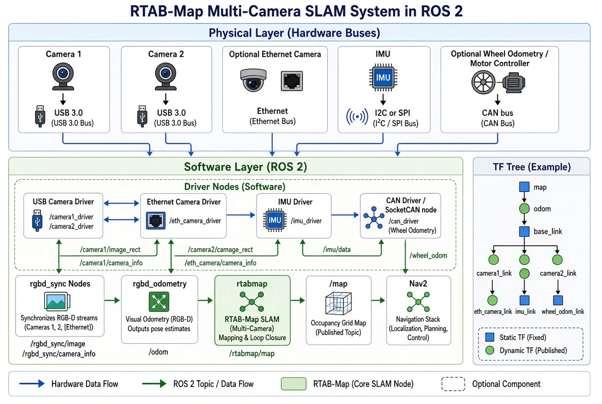

# RTAB-Map Multi-Camera Architecture

This document explains the complete flow of a multi-camera RTAB-Map SLAM system in ROS 2.  
It separates the **Physical Layer** (hardware buses) from the **Software Layer** (ROS 2 nodes) and describes how data moves through the system.

## Architecture Diagram



## System Flow Overview

Data flows from left to right and top to bottom:

1. **Physical sensors** send data over hardware buses.
2. **Driver nodes** convert the raw data into ROS 2 topics.
3. **Synchronization and odometry** nodes process the data.
4. **rtabmap** performs SLAM and creates the map.
5. **Nav2** uses the map for navigation.
6. **TF** provides the spatial relationships required by almost every node.

## 1. Physical Layer (Hardware Buses)

This layer shows how sensors are physically connected to the computer.

| Sensor | Physical Bus | Description |
|--------|--------------|-------------|
| Camera 1 | USB 3.0 | Main RGB-D camera (front) |
| Camera 2 | USB 3.0 | Second RGB-D camera (rear or side) |
| Optional Ethernet Camera | Ethernet | Industrial or GigE Vision camera |
| IMU | I2C or SPI | Inertial Measurement Unit |
| Optional Wheel Odometry / Motor Controller | CAN bus | Wheel encoders or motor controller |

**Important**: These are real physical connections (cables and buses). No ROS communication happens here yet.

## 2. Software Layer (ROS 2)

Once the data arrives at the computer, everything becomes software communication using ROS 2 topics (DDS).

### Driver Nodes
These nodes read from the physical buses and publish ROS 2 messages:

- **USB Camera Driver** – Publishes images and camera info from USB cameras.
- **Ethernet Camera Driver** – Same function for Ethernet cameras.
- **IMU Driver** – Publishes IMU data.
- **CAN Driver / SocketCAN node** – Publishes wheel odometry from the CAN bus.

### Processing Nodes

| Node | Role | Input | Output |
|------|------|-------|--------|
| **rgbd_sync Nodes** | Synchronize RGB + Depth + CameraInfo for each camera | Camera topics | `rgbd_image0`, `rgbd_image1`, ... |
| **rgbd_odometry** | Computes visual odometry (can use multiple cameras) | Synchronized RGB-D images | `/odom` |
| **rtabmap** | Main SLAM node (loop closure + mapping) | RGB-D images + odometry | `/map` (occupancy grid) |
| **Nav2** | Navigation stack | `/map` + robot pose | Velocity commands |

## How TF Works

**TF converts data from the pure sensor point of view into the robot’s point of view.**

Every sensor sees the world from its own position and orientation. TF tells the system exactly where that sensor is mounted on the robot so that all measurements can be transformed into a common coordinate frame (usually `base_link`).

### Simple Example: Camera Mounted on the Robot

Imagine a camera is physically mounted **0.2 meters in front** of the robot’s center and **0.3 meters above** the ground, pointing straight ahead.

- The camera’s own frame is called `camera1_link`.
- The robot’s body frame is called `base_link`.

The TF transform between them looks like this:

```text
base_link → camera1_link
Translation: x = 0.2 m, y = 0.0 m, z = 0.3 m
Rotation:    0° (no rotation)
```

In ROS this is published as a static transform. When the camera detects an obstacle 1.5 meters in front of itself, TF automatically converts that measurement so the system knows the obstacle is 1.7 meters in front of the robot’s `base_link`.

### Why This Matters
- Without TF, every camera would report obstacles relative to itself.
- With TF, all cameras report obstacles relative to the same robot frame (`base_link`).
- This allows multiple cameras to build one consistent map.

### Typical TF Tree
```text
map
 └── odom
      └── base_link
           ├── camera1_link
           ├── camera2_link
           ├── eth_camera_link
           ├── imu_link
           └── wheel_odom_link
```

### Why TF Is Essential
- Tells `rgbd_odometry` and `rtabmap` where each camera is mounted.
- Allows data from multiple sensors to be fused into one consistent map.
- Required by Nav2 to know the robot’s position relative to the map and obstacles.
- Incorrect TF is one of the most common causes of mapping failure.

## Complete Data Flow Summary

```text
Physical Sensors
    │
    │  (USB / Ethernet / I2C / CAN)
    ▼
Driver Nodes
    │
    │  (ROS 2 Topics)
    ▼
rgbd_sync → rgbd_odometry → rtabmap → /map → Nav2
    ▲
    │
   TF Tree (spatial relationships)
```

### Key Points
- **Physical buses** bring raw sensor data into the computer.
- **Driver nodes** convert that data into ROS 2 topics.
- **All further communication** between nodes is pure software (DDS topics).
- **TF** is required for correct multi-sensor fusion and navigation.
- Optional components (Ethernet camera, CAN odometry) can be added without changing the core SLAM flow.

---

*Document for learning RTAB-Map multi-camera systems in ROS 2.*
