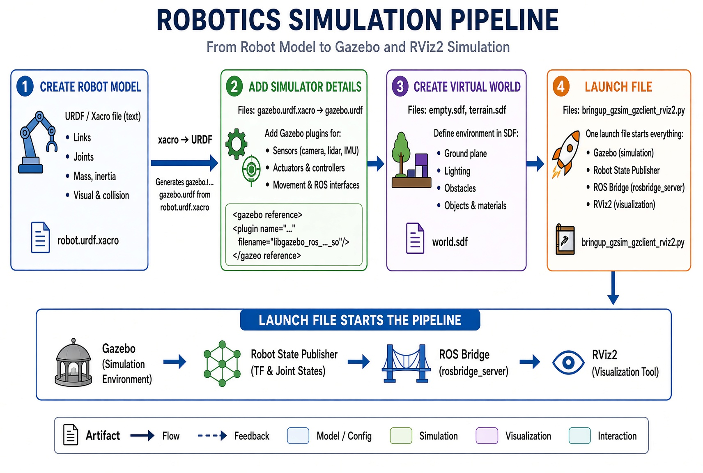

# Robotics Simulation Workflow

This explains the order of steps, the files you create, what “.xacro to .urdf” means, and which tool uses which files. Everything is written in plain language.

## Clear Order of Work (What Comes First)

1. **Create the basic robot model** (you write this first)
2. **Add simulator details** (you add extra instructions for the 3D world)
3. **Create the virtual world** (ground, lights, obstacles)
4. **Write the launch file** (the script that starts everything)
5. **Run the launch file** → Gazebo, Robot State Publisher, Bridge, and RViz2 all start and connect

You always finish the files in steps 1–4 before you run anything.

## What “.xacro to .urdf” Means

- You usually write the robot description in a **.xacro** file (example: `robot.urdf.xacro` or `gazebo.urdf.xacro`).
- Xacro is just a smarter text format. It lets you reuse parts and use simple calculations so the file stays short and easy to change.
- When the system needs the robot description, a small tool automatically turns the `.xacro` file into a plain `.urdf` file.
- You do **not** edit the `.urdf` file by hand. You only edit the `.xacro` file. The conversion happens automatically when you launch.

In the diagram this is shown as `gazebo.urdf.xacro → gazebo.urdf`.

## File Artifacts and Which Tool Uses Them

| File you create              | What it contains                          | Which tool reads it                          |
|-----------------------------|-------------------------------------------|----------------------------------------------|
| `robot.urdf.xacro`          | Basic robot: body, wheels, joints, weight | Launch file turns it into URDF and gives it to Robot State Publisher + RViz2 |
| `gazebo.urdf.xacro`         | Extra simulator instructions (plugins for sensors, movement, friction) | Launch file turns it into URDF and gives it to Gazebo |
| `world.sdf` (or `empty.sdf`, `terrain.sdf`) | Virtual environment: ground, lights, obstacles | Gazebo loads this directly |
| `bringup.launch.py` (or similar) | The script that starts all programs and connects them | You run this file; it starts Gazebo, Robot State Publisher, Bridge, and RViz2 |

### How the tools use the files at runtime

- **Gazebo** (3D simulator)  
  Uses: `world.sdf` + the converted `gazebo.urdf`  
  Does: physics, collisions, sensor simulation, wheel movement

- **Robot State Publisher**  
  Uses: the converted robot URDF  
  Does: continuously calculates the position of every part of the robot

- **Bridge**  
  Uses: no model files (it only moves messages)  
  Does: carries “move forward” commands into Gazebo and brings sensor data back out

- **RViz2** (screen viewer)  
  Uses: the converted robot URDF + data coming from the Bridge and Robot State Publisher  
  Does: shows the robot model, laser dots, camera images, and coordinate frames on your screen

## Detailed Step-by-Step Explanation

### 1. Create Robot Model
Write `robot.urdf.xacro`.  
Describe the solid parts (links), how they connect (joints), their size, color, and weight.  
This file is the foundation. Everything else builds on it.

### 2. Add Simulator Details
Write (or extend) `gazebo.urdf.xacro`.  
Add the extra pieces Gazebo needs:
- Friction and material properties
- Sensor plugins (camera, laser, etc.)
- Movement plugin so the wheels respond to commands

This file is converted to a plain `.urdf` only when the launch file runs.

### 3. Create Virtual World
Write `world.sdf` (or `empty.sdf`).  
Describe the ground plane, lighting, gravity, and any obstacles.  
Gazebo loads this file directly when it starts.

### 4. Launch File
Write `bringup.launch.py` (name can vary).  
This single script:
- Converts the `.xacro` files into `.urdf`
- Starts Gazebo and loads the world
- Places the robot in the world
- Starts Robot State Publisher
- Starts the Bridge
- Starts RViz2

### After you run the launch file
- Gazebo runs the physics and sensors using the world file + gazebo robot description.
- Robot State Publisher keeps the part positions updated.
- The Bridge shares commands and sensor data.
- RViz2 shows everything on your screen so you can watch and control the robot.

This order never changes, no matter how complex the robot becomes. You only add more detail inside the same files.