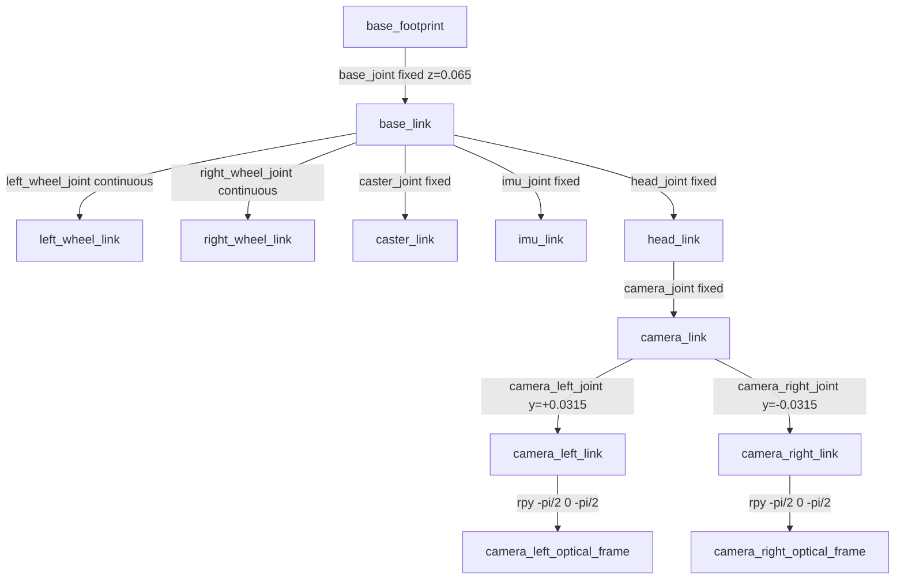

# Stereo Eye: robot design document 🤖👁️

This package holds **only the robot model** of Stereo Eye (`stereo_eye`), a small, cute 2-wheel differential-drive robot.
It is built to map rooms with RTAB-Map stereo SLAM using **one stereo camera as its single big eye**.
Simulation worlds, launch files, bridges and SLAM configuration are deliberately left out. Other packages and tools handle those.

---

## 1. Concept and look

The design is based on the user's reference robot: a boxy, white/light-grey "mecha" torso with blue accent stripes,
a vented front chest panel, and a wide flat head bar on a short neck. For a mapping platform, the **legs and arms are removed**.
The torso sits directly between two big drive wheels, with a small caster ball at the back.

How it was made cute:

| Feature | How it's built |
|---|---|
| Chunky proportions | A short, wide torso (15 × 14 × 15 cm) with **rounded vertical edges** (2 crossed boxes + 4 corner cylinders), and big wheels (Ø13 cm) that reach almost half the body height |
| One big eye | The stereo camera *is* the eye: a blue rim → light-grey bezel → dark glass disc with both stereo lenses (light blue) inside, plus a white **sparkle** sphere for a "catch-light" |
| Pill-shaped head | A box with two cylinder ends, which looks like a rounded bar from the front. It has **blue ear lights** on both sides and a thin blue brow strip on top |
| Blush cheeks | Two pink discs under the eye |
| Twin antennas | Thin grey rods tilted outward, each with a blue ball tip |
| Reference styling | A blue collar band near the top and a blue bumper band at the bottom, a light-grey chest panel with 3 dark vent slits, blue vertical stripes on each side of the panel, a small sky-blue status light, a grey shoulder cap and a blue neck |
| Wheels | Dark tyres, blue hubs, white hub caps |

All visuals use **primitives only** (box / cylinder / sphere), so the URDF opens anywhere without mesh files.

## 2. Overall dimensions

| Quantity | Value |
|---|---|
| Length (x), wheel front to caster back | 16.2 cm |
| Width (y), head bar incl. ear lights (widest part) | 25.5 cm |
| Width across wheel outer faces | 22.0 cm |
| Height to head top / to antenna tips | 30.5 cm / 34.2 cm |
| Torso (rounded box) | 14.0 (x) × 15.0 (y) × 15.0 (z) cm, corner radius 2.5 cm, from 3 cm to 18 cm above ground |
| Shoulder cap / neck | 1 cm cap (18-19 cm); neck cylinder r 2.2 cm (19-21 cm) |
| Head | 9.0 (x) × 15.0 cm flat core + two r 4.75 cm round ends (24.5 cm wide) × 9.5 cm tall, from 21 cm to 30.5 cm |
| Ground clearance (torso) | 3.0 cm |
| Total mass | 3.16 kg |

## 3. Link / joint tree



| Frame | Pose (relative to its parent) | Purpose |
|---|---|---|
| `base_footprint` | root, on the ground under the axle centre | 2D robot pose for navigation/SLAM (`frame_id` for RTAB-Map); child of `odom` at runtime |
| `base_link` | z = +0.065 (axle height) | Main body. Carries the torso, bands, chest panel, cap, neck and caster housing visuals, the torso collision box and the torso+battery mass |
| `left_wheel_link` / `right_wheel_link` | y = ±0.095, rpy (−π/2, 0, 0), axis z | Drive wheels. The rotation makes both wheel z-axes point to +y, so a positive joint velocity drives forward on both sides |
| `caster_link` | x = −0.075, z = −0.0475 (sphere touches the ground) | Rear support ball (fixed; frictionless in Gazebo) |
| `imu_link` | z = +0.01, on the axle centreline | IMU mounting point, near the rotation centre to reduce centripetal acceleration |
| `head_link` | z = +0.1925 | Head bar with the eye, cheeks, ears and antennas; head collision box and head mass |
| `camera_link` | x = +0.061, z = +0.005 from the head centre | Stereo camera body. The origin is at the lens front, midway between the lenses. x forward (REP-103 body convention) |
| `camera_left_link` / `camera_right_link` | y = ±0.0315 | Individual eye positions (where the Gazebo sensors attach) |
| `camera_left_optical_frame` / `camera_right_optical_frame` | rpy (−π/2, 0, −π/2) | Optical frames: **z forward, x right, y down** (REP-103 optical convention), used as the `frame_id` of images and camera_info |

All joints are fixed except the two continuous wheel joints (effort 2 N·m, velocity 15 rad/s, damping 0.01).

## 4. Drive geometry

| Parameter | Value |
|---|---|
| Wheel radius / width | 0.065 m / 0.030 m |
| Wheel separation (centre to centre) | 0.190 m |
| Gap between wheel and torso side | 5 mm |
| Caster | Rear ball r = 0.0175 m at x = −0.075 m |
| Support polygon | Triangle formed by the two wheel contacts (x = 0) and the caster (x = −0.075) |

**Why the COM is behind the axle.** With only two wheels and one rear caster, the robot stands stably only if the
centre of mass lies *inside* the support triangle, between the axle (x = 0) and the caster (x = −0.075).
The head and camera sit forward of the axle. To compensate, the torso box is offset 2 cm rearward, and the torso's
inertial origin (battery, motors, computer) is placed low and further back, at (−0.03, 0, +0.01) relative to `base_link`.
The resulting overall COM is **x = −2.1 cm, z = 9.6 cm** above the ground. It is well behind the axle, so the robot rests on
the caster, and it is low enough that moderate braking doesn't tip it forward.

## 5. Mass budget and inertia

| Link | Mass (kg) | Inertia primitive | Ixx / Iyy / Izz (kg·m²) |
|---|---|---|---|
| base_link (torso shell + battery + motors + SBC) | 2.20 | box 0.14 × 0.15 × 0.15 | 0.008250 / 0.007718 / 0.007718 |
| head_link (head shell + neck) | 0.35 | box 0.09 × 0.245 × 0.095 | 0.002014 / 0.000499 / 0.001987 |
| camera_link | 0.06 | box 0.025 × 0.09 × 0.03 | 4.5e-5 / 8e-6 / 4.4e-5 |
| left / right wheel | 2 × 0.25 | solid cylinder r 0.065, h 0.03 | 0.000283 / 0.000283 / 0.000528 (axis z) |
| caster_link | 0.05 | solid sphere r 0.0175 | 6e-6 each |
| **Total** | **3.16** | | |

The inertias are computed by the xacro macros from the standard solid-primitive formulas:

* box: `Ixx = m(y²+z²)/12`, `Iyy = m(x²+z²)/12`, `Izz = m(x²+y²)/12`
* cylinder (axis z): `Ixx = Iyy = m(3r²+h²)/12`, `Izz = m r²/2`
* sphere: `I = 2/5 m r²`

All tensors are positive and satisfy the triangle inequality. Frame links (`base_footprint`, `imu_link`, `camera_*_link`,
optical frames) are massless on purpose. Gazebo merges them into their parents.

## 6. Stereo camera (the eye)

| Parameter | Value |
|---|---|
| Type | Single stereo pair, ZED-Mini / OAK-D-like |
| Baseline | **0.063 m** (lenses at y = ±0.0315 in `camera_link`) |
| Resolution | **1280 × 720 (720p) per eye**, R8G8B8 |
| Frame rate | 30 fps |
| Horizontal FOV | 1.6 rad (91.7°); vertical ≈ 1.05 rad (60°) from the 16:9 aspect |
| Focal length | fx = fy = (1280/2) / tan(1.6/2) = **621.58 px**; cx = 640, cy = 360 |
| Right-camera projection Tx | −fx · B = **−39.16** (so `camera_info` P[3] carries the baseline for stereo/RTAB-Map) |
| Clip range (sim) | 0.05-40 m |
| Mounting height | lens centre **0.2625 m** above ground, 0.061 m ahead of the axle, looking straight ahead (0° pitch) |
| Optical frames | `camera_left_optical_frame`, `camera_right_optical_frame`, rpy (−π/2, 0, −π/2) per **REP-103** |

The camera is high and level so it sees furniture and walls instead of the floor. With a 60° vertical FOV, the floor
comes into view about 0.45 m in front of the robot.

## 7. Materials / colours

| Material | RGBA | Used for |
|---|---|---|
| `se_white` | 0.96 0.96 0.97 1 | Torso, head, hub caps, eye sparkle |
| `se_light_grey` | 0.80 0.82 0.85 1 | Chest panel, shoulder cap, eye bezel, antenna rods, caster housing |
| `se_blue` | 0.12 0.47 0.95 1 | Collar and bumper bands, chest stripes, neck, eye rim, ear lights, brow, antenna tips, hubs |
| `se_sky` | 0.45 0.75 1.00 1 | Stereo lenses, status light |
| `se_dark` | 0.10 0.11 0.14 1 | Vent slits, caster ball |
| `se_glass` | 0.03 0.05 0.10 1 | Eye glass |
| `se_tire` | 0.18 0.19 0.22 1 | Tyres |
| `se_blush` | 1.00 0.55 0.65 1 | Cheeks |

## 8. Xacro structure and how to tweak it

`urdf/stereo_eye.urdf.xacro` is organised top to bottom:

1. **Argument**: `use_gazebo` (default `true`), which includes the optional Gazebo file.
2. **Properties**: every dimension in one place: `wheel_radius`, `wheel_width`, `wheel_separation`, `torso_x/y/z`,
   `torso_r`, `torso_off_x`, `ground_clear`, `head_x`, `head_core_y`, `head_z`, `neck_r/h`, `cap_h`, eye sizes (`bezel_r`, `glass_r`, `lens_r`, `eye_z`),
   camera (`stereo_baseline`, `cam_w`, `cam_h`, `cam_fps`, `cam_hfov`; `cam_fx` is **derived**), caster (`caster_r`, `caster_x`), and masses.
   Derived heights (`torso_cz`, `torso_top`, `head_cz`, `cam_front_x`) are computed, so the stack stays connected when you change a size.
3. **Materials**: the 8 colours above.
4. **Inertial macros**: `box_inertial`, `cylinder_inertial`, `sphere_inertial` (mass + dimensions + origin block).
5. **Visual helper macros**: `rounded_box_visual` (+ `rounded_corner`), `front_disc` (a disc facing +x), `vbox`.
6. **`drive_wheel` macro** (`prefix`, `reflect`): wheel link (tyre/hub/cap visuals, cylinder collision, inertia), continuous joint
   and Gazebo friction (`mu1 = mu2 = 1.0`).
7. **`stereo_eye` macro** (`side`, `reflect`): eye link + optical frame.
8. **Links and joints**: base_footprint → base_link → wheels, caster, imu, head → camera.

Examples:
* Bigger wheels: change `wheel_radius`. Everything above the axle moves with it, and the caster offset is recalculated.
* A different camera (e.g. OAK-D Lite, 75 mm): set `stereo_baseline`, `cam_hfov`, `cam_w`, `cam_h`, and `cam_fx` and `tx` update automatically.
* Heavier battery: change `torso_mass` (and recheck that the COM stays behind the axle).

Collision geometry is kept simple: torso box, head box, wheel cylinders, caster sphere.

## 9. Optional Gazebo file (`urdf/stereo_eye.gazebo.xacro`)

This file is included only when `use_gazebo:=true`. It holds **Gazebo Harmonic (gz-sim 8) tags**, so the core model stays
simulator-agnostic. It declares:

| Element | Details |
|---|---|
| `stereo_left`, `stereo_right` camera sensors | On `camera_left_link` / `camera_right_link`: 1280×720, 30 Hz, HFOV 1.6, Gaussian noise σ 0.005, lens intrinsics + projection (right Tx = −39.16), topics `stereo/{left,right}/image_raw` + `stereo/{left,right}/camera_info`, `gz_frame_id` = the optical frame |
| `imu_sensor` | On `imu_link`, 100 Hz, topic `imu`, gyro σ 0.0009 rad/s, accel σ 0.017 m/s² |
| DiffDrive plugin | `left/right_wheel_joint`, separation 0.19, radius 0.065, limits ±0.6 m/s, ±2 rad/s, ±1 m/s², ±3 rad/s²; `cmd_vel` → `odom` + `tf` (odom → base_footprint) at 30 Hz |
| JointStatePublisher plugin | Publishes both wheel joints on `joint_states` |

The wheel and caster friction tags (`mu1`/`mu2`) live in the main xacro, next to their links. They are ignored by non-Gazebo tools.
The world must load the `Sensors` (ogre2) and `Imu` systems for the cameras and IMU to publish. That belongs to the simulation package, not here.

## 10. Export files and why

Only the model source is shipped:

| File | Why it exists |
|---|---|
| `urdf/stereo_eye.urdf.xacro` | **Source of truth.** Parametric (properties + macros), so you edit this file. ROS tools expand it on the fly with `xacro` |
| `urdf/stereo_eye.gazebo.xacro` | Optional Gazebo Harmonic sensors and plugins, kept separate so the core model stays simulator-agnostic. Included only when `use_gazebo:=true` |
| `urdf/stereo_eye.urdf` | **Plain pre-expanded URDF**, for tools that can't run xacro: Phobos (Blender), Isaac Sim / Omniverse URDF importer, MATLAB, PyBullet, MuJoCo's URDF compiler, Webots importer, online URDF viewers. Generated with the Gazebo tags included (non-Gazebo tools ignore them) |
| `package.xml`, `CMakeLists.txt` | Make this a ROS 2 package, so `$(find stereo_eye)` and `package://stereo_eye/...` resolve and the model installs to `share/stereo_eye/urdf`. Needed by robot_state_publisher, RViz, Gazebo spawners and any launch file another package writes. The only dependency is `xacro` |

**No mesh files are needed.** Every visual and collision is a URDF primitive (box / cylinder / sphere), and the URDF
contains no `package://` or `<mesh>` references. It loads as-is in RViz, Gazebo, Isaac Sim, PyBullet, MuJoCo, Webots
and Blender (via Phobos).

**Mesh exports (GLB / OBJ+MTL / STL) are available on request.** They are generated from this URDF, so they always match it.
They would be needed for:
* **Blender without add-ons:** Blender has no native URDF importer. A `.glb` opens directly (File → Import → glTF 2.0) with all colours and named parts. Use the Phobos add-on instead if you need the joints.
* **3D and game tools without URDF support:** Unity, Unreal, three.js, Sketchfab and similar take GLB/OBJ.
* **CAD, slicers and 3D printing:** STL / OBJ (STL can't store colours).
* Using a styled mesh as the robot's visual instead of primitives (it would then go in a `meshes/` folder referenced via `package://stereo_eye/meshes/...`).

A mesh export is a single static pose (wheels at 0). It doesn't carry links, joints, inertia or sensors, so it complements the URDF and can't replace it.

## 11. Regenerate the URDF

Without ROS:
```bash
pip install xacro
cd stereo_eye
xacro urdf/stereo_eye.urdf.xacro > urdf/stereo_eye.urdf                      # with Gazebo tags
xacro urdf/stereo_eye.urdf.xacro use_gazebo:=false > /tmp/stereo_eye_nogz.urdf  # simulator-free variant
```
With ROS 2:
```bash
cp -r stereo_eye ~/ws/src/ && cd ~/ws && colcon build --packages-select stereo_eye && source install/setup.bash
xacro $(ros2 pkg prefix stereo_eye)/share/stereo_eye/urdf/stereo_eye.urdf.xacro > stereo_eye.urdf
check_urdf stereo_eye.urdf      # from liburdfdom-tools
```
To view it, pass `robot_description:="$(xacro ...)"` to `robot_state_publisher` and run `joint_state_publisher_gui` + RViz.
The Gazebo file is included by relative path, so expansion works from both the source folder and the install folder.

## 12. Validation (current files)

```
robot name is: stereo_eye
root Link: base_footprint
  base_link ─ left_wheel_link [continuous], right_wheel_link [continuous], caster_link, imu_link,
              head_link ─ camera_link ─ camera_left_link ─ camera_left_optical_frame
                                      └ camera_right_link ─ camera_right_optical_frame
links: 12  joints: 11  total mass: 3.160 kg  COM: (-0.0211, 0, 0.0963) m
inertia tensors positive & triangle inequality: True
optical z-axis = +x (forward) for both eyes; stereo baseline 0.063 m
no <mesh> / package:// references (primitives only)
```
xacro expands without errors both with and without the Gazebo file.
