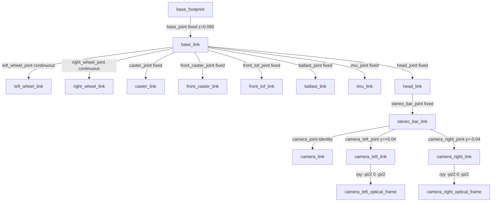

# Stereo Eye: robot design document 🤖👁️

This package holds **only the robot model** of Stereo Eye (`stereo_eye`), a small, cute 2-wheel differential-drive robot.
It is built to map rooms with RTAB-Map stereo SLAM using **one stereo camera as its single big eye**.
Simulation worlds, launch files, bridges and SLAM configuration are deliberately left out. Other packages and tools handle those.

---

## 1. Concept and look

The design is based on the user's reference robot: a boxy, white/light-grey "mecha" torso with blue accent stripes,
a vented front chest panel, and a wide flat head bar on a short neck. For a mapping platform, the **legs and arms are removed**.
The torso sits directly between two big drive wheels, with a small caster ball at the back and a matching one at the front (so a hard stop cannot tip it onto its face), and a tiny ToF ranger on the front, just ahead of the forward caster.

How it was made cute:

| Feature | How it's built |
|---|---|
| Chunky proportions | A short, wide torso (15 × 14 × 15 cm) with **rounded vertical edges** (2 crossed boxes + 4 corner cylinders), and big wheels (Ø13 cm) that reach almost half the body height |
| One big eye | The stereo pair *is* the eye: a single wide "visor" (stadium shape) with a blue rim → light-grey bezel → dark glass, both stereo lenses (light blue, 80 mm apart) inside, plus a white **sparkle** sphere for a "catch-light" |
| Pill-shaped head | A box with two cylinder ends, which looks like a rounded bar from the front. It has **blue ear lights** on both sides and a thin blue brow strip on top |
| Blush cheeks | Two pink discs under the outer ends of the visor |
| Twin antennas | Thin grey rods tilted outward, each with a blue ball tip |
| Reference styling | A blue collar band near the top and a blue bumper band at the bottom, a light-grey chest panel with 3 dark vent slits, blue vertical stripes on each side of the panel, a small sky-blue status light, a grey shoulder cap and a blue neck |
| Wheels | Dark tyres, blue hubs, white hub caps |
| Twin caster balls | A dark ball and a light-grey housing at both the front and the back, like little feet |
| Front ToF | A small dark housing with a sky-blue window, like a little nose, that measures range to whatever is just in front |

All visuals use **primitives only** (box / cylinder / sphere), so the URDF opens anywhere without mesh files.

## 2. Overall dimensions

| Quantity | Value |
|---|---|
| Length (x), ToF front to rear-caster back | 20.7 cm |
| Width (y), head bar incl. ear lights (widest part) | 25.5 cm |
| Width across wheel outer faces | 22.0 cm |
| Height to head top / to antenna tips | 30.5 cm / 34.2 cm |
| Torso (rounded box) | 14.0 (x) × 15.0 (y) × 15.0 (z) cm, corner radius 2.5 cm, from 3 cm to 18 cm above ground |
| Shoulder cap / neck | 1 cm cap (18-19 cm); neck cylinder r 2.2 cm (19-21 cm) |
| Head | 9.0 (x) × 15.0 cm flat core + two r 4.75 cm round ends (24.5 cm wide) × 9.5 cm tall, from 21 cm to 30.5 cm |
| Ground clearance (torso) | 3.0 cm |
| Total mass | 4.08 kg |

## 3. Link / joint tree



| Frame | Pose (relative to its parent) | Purpose |
|---|---|---|
| `base_footprint` | root, on the ground under the axle centre | 2D robot pose for navigation/SLAM (`frame_id` for RTAB-Map); child of `odom` at runtime |
| `base_link` | z = +0.065 (axle height) | Main body. Carries the torso, bands, chest panel, cap, neck and both caster-housing visuals, the torso collision box and the light torso-shell mass |
| `left_wheel_link` / `right_wheel_link` | y = ±0.095, rpy (−π/2, 0, 0), axis z | Drive wheels. The rotation makes both wheel z-axes point to +y, so a positive joint velocity drives forward on both sides |
| `caster_link` | x = −0.075, z = −0.0475 (sphere touches the ground) | Rear support ball (fixed; low friction μ = 0.01 in Gazebo) |
| `front_caster_link` | x = +0.075, z = −0.0475 (sphere touches the ground) | Front support ball / skid (fixed; same size and μ = 0.01). Stops the robot pitching onto its face |
| `front_tof_link` | x = +0.1175, z = −0.010 in `base_link` (optical centre 5.5 cm above the ground, 3 mm in front of the housing face) | Short-range ToF. Origin is the optical centre, 3 mm in front of a 2.0 × 2.4 × 1.6 cm housing that sits 2 mm in front of the front caster. Housing and window sit fully behind the origin. Looks straight ahead. |
| `ballast_link` | x = −0.025, z = −0.010 in `base_link` (5.5 cm above the ground) | Internal 2.40 kg battery pack on the torso floor (no visual or collision; it sits inside the shell) |
| `imu_link` | z = +0.01, on the axle centreline | IMU mounting point, near the rotation centre to reduce centripetal acceleration |
| `head_link` | z = +0.1925 | Head bar with the eye, cheeks, ears and antennas; head collision box and head mass |
| `stereo_bar_link` | x = +0.061, z = +0.005 from the head centre | **Rigid stereo bar** that carries both cameras (and the lens visuals and the camera mass). The origin is at the lens front, midway between the lenses. x forward |
| `camera_link` | identity on the bar | Stereo-pair centre frame (massless), kept for drivers and tools that expect `camera_link` |
| `camera_left_link` / `camera_right_link` | y = ±0.04 on the bar | Individual camera positions, x forward (where the Gazebo sensors attach) |
| `camera_left_optical_frame` / `camera_right_optical_frame` | rpy (−π/2, 0, −π/2) | Optical frames: **z forward, x right, y down** (REP-103 optical convention), used as the `frame_id` of images and camera_info |

All joints are fixed except the two continuous wheel joints (effort 2 N·m, velocity 15 rad/s, damping 0.01).

## 4. Drive geometry and tip-over stability

| Parameter | Value |
|---|---|
| Wheel radius / width | 0.065 m / 0.030 m |
| Wheel separation (centre to centre) | 0.190 m |
| Gap between wheel and torso side | 5 mm |
| Rear caster | Ball r = 0.0175 m at x = −0.075 m, μ = 0.01 |
| Front caster / skid | Same ball at x = +0.075 m, μ = 0.01 |
| Support polygon | Quadrilateral: the two wheel contacts (x = 0, y = ±0.095) plus the front and rear casters (x = ±0.075, y = 0) |
| Wheel friction | μ = 1.2, with contact kp = 1e6, kd = 100, minDepth = 0.001 (same contact numbers on the casters) |
| DiffDrive command limits | ±0.3 m/s, ±1.0 rad/s, ±0.5 m/s², ±1.5 rad/s² |

**Why it tipped onto its face.** The first model had only a rear caster. The two drive wheels and that one
rear ball made a support *triangle* whose front edge was the wheel axle (x = 0). Nothing in front of the
axle touched the ground. The centre of mass sat only 2.1 cm behind that axle, 9.6 cm above the ground.
When you brake (or command a sudden reverse) while driving forward, the robot's own inertia pushes its
weight *forward*. If that weight line crosses the front edge of the support polygon, the robot pitches
onto its face. Once the head is on the floor, the drive wheels are in the air, so teleop cannot pick it
back up. That is what happened in Gazebo.

**Centre of mass (COM)** is the balance point of all the mass, as if the whole robot were a single
weight hanging there. **Support polygon** is the shape on the floor between the points that actually
touch the ground. The robot stands still only while a vertical line through the COM hits the floor
*inside* that shape, with some margin.

**The braking-tilt check.** A forward deceleration *a* is equivalent to tilting gravity toward the
front by θ = atan(*a*/*g*). The weight line then hits the floor at

&nbsp;&nbsp;&nbsp;&nbsp;x_hit = x_COM + z_COM · (*a* / *g*)

(with *g* = 9.81 m/s²). We require x_hit to stay behind the front edge of the support polygon at
*a* = 0.5 m/s² (θ ≈ 2.9°), which is also the DiffDrive linear-acceleration limit. The same idea going
the other way (accelerating forward) is x_hit = x_COM − z_COM · (*a* / *g*), and that point must stay
ahead of the rear caster.

| | Before (rear caster only) | After (front + rear casters, lower COM) |
|---|---|---|
| Total mass | 3.160 kg | **4.080 kg** |
| COM in `base_footprint` | (−0.0212, 0, 0.0963) m | **(−0.0174, 0, 0.0781) m** |
| Front edge of the support polygon | axle, x = 0 | front caster, x = +0.075 m |
| Static forward margin (x_front − x_COM) | 2.12 cm | **9.24 cm** |
| Static rearward margin (x_COM − x_rear) | 5.38 cm | **5.76 cm** |
| Forward braking at 0.5 m/s² (x_front − x_hit) | 1.63 cm (tight) | **8.85 cm** |
| Forward accel at 0.5 m/s² (x_hit − x_rear) | 4.89 cm | **5.36 cm** |

The 1.6 cm braking margin of the old model was not enough. A bump, a collision, or a hard teleop
press could push the weight line past the axle, and with no front support the fall could not be
caught. Just lowering the COM, without a front caster, would have left only about 1.4 cm of forward
braking margin (the new COM is also a few millimetres closer to the axle). The front caster is the
real fix: it moves the front edge 7.5 cm forward of the axle, so the same 0.5 m/s² stop has nearly
9 cm of margin. The ball is the same size as the rear one, sits under the front of the torso (the
visor stays well above the ground if the robot leans onto it), and uses the same low friction so a
fixed, non-swivelling ball does not drag the heading or fight the differential drive. The drive
wheels keep high friction (μ = 1.2) so they can actually apply the commanded speed.

The front ToF (section below) sits 4.7 cm off the ground and only weighs 0.02 kg, so it is
**not** part of the support polygon and only nudged the COM a few millimetres (margins are
within 2 mm of the tip-proof values before the bumper or ToF were added).


**How the COM was lowered.** The 2.20 kg torso mass used to include the battery, and the head was
0.35 kg of mass high up on the neck. The torso shell is now a light 0.80 kg body whose inertia sits
at the geometric centre of the box. A separate 2.40 kg `ballast_link` (a 12 × 13 × 5 cm battery pack
and chassis plate, density about 3077 kg/m³) sits on the *floor* of the torso, 5.5 cm above the
ground and 2.5 cm behind the axle. The head was lightened to 0.20 kg (hollow plastic). The cameras
stay 0.06 kg. The net result: 1.8 cm lower COM (9.63 cm → 7.82 cm) and a 0.90 kg mass increase.

**What the velocity and acceleration limits do.** They do **not** change the physics of the body.
They cap the *twist command* inside the DiffDrive plugin (ign-gazebo6 elements
`max/min_linear_velocity`, `max/min_angular_velocity`, `max/min_linear_acceleration`,
`max/min_angular_acceleration`). A hard teleop key press is clamped to 0.3 m/s and 1.0 rad/s, and
the plugin may only ramp those speeds at 0.5 m/s² and 1.5 rad/s². That is why a key slam cannot
demand a harder stop than the support-polygon check above. The previous limits were 0.6 m/s,
2.0 rad/s, 1.0 m/s² and 3.0 rad/s².

### Front ToF range sensor

Stereo cameras estimate depth from disparity. In practice this pair is unreliable closer
than about 0.17-0.35 m (the near "blind zone"), so a planner that only looks at the stereo
cloud can drive the robot into a wall in that last stretch. The front ToF is a short-range
feeler that sits under the cameras and measures distance to whatever is just ahead.

**Why 1.0 m and 50 deg.** The default max range (`tof_max_range`) is 1.0 m and the
horizontal FOV (`tof_hfov`) is 50 deg so the feeler sees plain furniture earlier —
textureless boxes and chair legs that stereo often misses — including pieces slightly
off to the side. That still *overlaps* the stereo near band (~0.17-0.35 m) and now
covers well past it, so there is no gap between the two. (A 0.10 m cap would have
left 0.10-0.17/0.35 m uncovered; 0.30 m already overlapped the near band but only
saw a box in the last 30 cm.) 50 deg is the middle of a 45-60 deg window: wide
enough for furniture just off the nose, not so wide that hallway walls fill the
outer rays while hugging them. 21 horizontal samples keep the same 2.5 deg step
as the old 11 samples over 25 deg. Raise `tof_max_range` or `tof_hfov` in the
xacro (and regenerate the URDF) if you want a longer or wider feeler. The
launcher costmaps must also raise their ToF `obstacle_max_range` (still 0.30 m
at the time of this change) or Nav2 will ignore everything past 30 cm.

**Min and max range.** `tof_min_range` (0.01 m) is the closest reading the sensor will
report: closer than that is treated as invalid. `tof_max_range` (1.0 m) is the farthest
it will report; nothing beyond that is seen by this sensor.

**Fake min-range readings.** ign-sensors6 `Lidar::Clamp` raises every *finite* range
below min up to exactly `range_min` (it leaves +/-inf alone). On the ogre1 (Fortress)
`gpu_lidar`, a no-hit first-pass pixel is supposed to be +inf, but the second-pass
target is cleared to 0.0, and a 1-row, few-sample point mesh can miss a pixel and
write that 0. A self-hit on the sensor's own visual does the same if it comes back
as a finite 0. Either way the published scan is a wall at `range_min` even in open
space, which used to trip false TOO CLOSE recoveries. Two model-side fixes: the
optical origin is 3 mm in front of the housing face, and every housing/window visual
and collision sits fully behind that origin (the window used to be a 2 mm cylinder
centred on the face, so 1 mm stuck out). And the scan is 21 horizontal samples over
50 deg plus 3 vertical samples over +/- 1 deg, so a single bad pixel is less likely
to pin the whole feeler. Downstream should still treat a reading at or below
`range_min` as invalid, not as a real obstacle.

The beam is aimed straight ahead (zero pitch) from 5.5 cm above the ground. The
lowest ray, at -1 deg, drops only 1.0*tan(1 deg) ~ 17 mm at max range, so it still
clears the floor by about 3.8 cm (it would need a downward pitch of at least
atan(0.055/1.0) ~ 3.1 deg to hit the ground). The housing sits 2 mm in front of the
front caster; the optical origin is 3 mm in front of the housing, and everything
else (casters, wheels, torso) is behind that origin, so the 50 deg fan also clears
the robot's own body — the outer rays at +/- 25 deg still only travel forward of
the origin. Horizontal and vertical sample counts, both FOVs and both range
limits are xacro properties (`tof_h_samples`, `tof_v_samples`, `tof_hfov`,
`tof_vfov`, `tof_min_range`, `tof_max_range`).

| Quantity | Value |
|---|---|
| Housing | 2.0 x 2.4 x 1.6 cm, 0.02 kg, dark box with a sky-blue window |
| Optical origin in `base_footprint` | (0.1175, 0, 0.055) m, x forward, no pitch, 3 mm in front of the housing face. Housing occupies x = 0.0945-0.1145 m, z = 0.047-0.063 m. Window is on the front face, entirely behind the origin. |
| Scan | gpu_lidar, 20 Hz, 21 horizontal samples over 50 deg, 3 vertical samples over +/- 1 deg |
| Range | 0.01-1.0 m (`tof_min_range` / `tof_max_range`) |
| gz topic | **`/front_tof`** (absolute, set at sensor level). ign-sensors6 also publishes **`/front_tof/points`**. |
| gz messages | `ignition.msgs.LaserScan` on `/front_tof`; `ignition.msgs.PointCloudPacked` on `/front_tof/points` |
| ROS bridge (Humble `ros_gz_bridge`) | `/front_tof@sensor_msgs/msg/LaserScan[gz.msgs.LaserScan` (or `ignition.msgs.LaserScan`; Humble accepts both). Optional points: `/front_tof/points@sensor_msgs/msg/PointCloud2[gz.msgs.PointCloudPacked`. |
| Frame | `front_tof_link`, set with both `<ignition_frame_id>` and `<gz_frame_id>` |
| World plugin | The existing Sensors system (`ignition-gazebo-sensors-system`, `render_engine` ogre) already in `apartment.sdf` is enough. The Contact system is **not** needed for this robot any more (it was only for the removed bumper). |

## 5. Mass budget and inertia

| Link | Mass (kg) | Inertia primitive | Ixx / Iyy / Izz (kg·m²) |
|---|---|---|---|
| base_link (torso shell) | 0.80 | box 0.14 × 0.15 × 0.15 | 0.003000 / 0.002807 / 0.002807 |
| ballast_link (battery pack + chassis plate, on the torso floor) | 2.40 | box 0.12 × 0.13 × 0.05 | 0.003880 / 0.003380 / 0.006260 |
| head_link (hollow plastic head) | 0.20 | box 0.09 × 0.245 × 0.095 | 0.001151 / 0.000285 / 0.001135 |
| stereo_bar_link (bar + both camera modules) | 0.06 | box 0.025 × 0.11 × 0.03 | 6.5e-5 / 7.6e-6 / 6.4e-5 |
| left / right wheel | 2 × 0.25 | solid cylinder r 0.065, h 0.03 | 0.000283 / 0.000283 / 0.000528 (axis z) |
| caster_link / front_caster_link | 2 × 0.05 | solid sphere r 0.0175 | 6e-6 each |
| front_tof_link | 0.02 | box 0.020 × 0.024 × 0.016 | 1.39e-6 / 1.09e-6 / 1.63e-6 |
| **Total** | **4.08** | | |

The inertias are computed by the xacro macros from the standard solid-primitive formulas:

* box: `Ixx = m(y²+z²)/12`, `Iyy = m(x²+z²)/12`, `Izz = m(x²+y²)/12`
* cylinder (axis z): `Ixx = Iyy = m(3r²+h²)/12`, `Izz = m r²/2`
* sphere: `I = 2/5 m r²`

All tensors are positive and satisfy the triangle inequality. Frame links (`base_footprint`, `imu_link`, `camera_*_link`,
optical frames) are massless on purpose. Gazebo merges them into their parents.

## 6. Stereo camera (the eye)

| Parameter | Value |
|---|---|
| Type | Single stereo pair, ZED-Mini / OAK-D-like |
| Baseline | **0.080 m** (lenses at y = ±0.04 on `stereo_bar_link`; why 80 mm: see `STEREO_DESIGN.md`) |
| Resolution | **640 × 360 per eye**, R8G8B8 (below the original ≥ 720p requirement: a deliberate trade for sim performance; set `cam_w=1280`, `cam_h=720` in the xacro to restore) |
| Frame rate | 24 fps, same rate for both cameras (synchronised) |
| Horizontal FOV | 1.5 rad (85.9°); vertical ≈ 0.965 rad (55.3°) from the 16:9 aspect |
| Focal length | fx = fy = (640/2) / tan(1.5/2) = **343.50 px**; cx = 320, cy = 180 (identical for both cameras) |
| Right-camera projection Tx | −fx · B = **−27.48** (so `camera_info` P[3] carries the baseline for stereo/RTAB-Map) |
| Clip range (sim) | 0.05-40 m |
| Mounting height | lens centre **0.2625 m** above ground, 0.061 m ahead of the axle, looking straight ahead (0° pitch) |
| Optical frames | `camera_left_optical_frame`, `camera_right_optical_frame`, rpy (−π/2, 0, −π/2) per **REP-103** |

The camera is high and level so it sees furniture and walls instead of the floor. With a 55° vertical FOV, the floor
comes into view about 0.50 m in front of the robot. Full stereo design, topics and launcher notes: [`STEREO_DESIGN.md`](STEREO_DESIGN.md).

## 7. Materials / colours

| Material | RGBA | Used for |
|---|---|---|
| `se_white` | 0.96 0.96 0.97 1 | Torso, head, hub caps, eye sparkle |
| `se_light_grey` | 0.80 0.82 0.85 1 | Chest panel, shoulder cap, eye bezel, antenna rods, caster housing |
| `se_blue` | 0.12 0.47 0.95 1 | Collar and bumper bands, chest stripes, neck, eye rim, ear lights, brow, antenna tips, hubs |
| `se_sky` | 0.45 0.75 1.00 1 | Stereo lenses, status light, ToF window |
| `se_dark` | 0.10 0.11 0.14 1 | Vent slits, caster balls, ToF housing |
| `se_glass` | 0.03 0.05 0.10 1 | Eye glass |
| `se_tire` | 0.18 0.19 0.22 1 | Tyres |
| `se_blush` | 1.00 0.55 0.65 1 | Cheeks |

## 8. Xacro structure and how to tweak it

`urdf/stereo_eye.urdf.xacro` is organised top to bottom:

1. **Argument**: `use_gazebo` (default `true`), which includes the optional Gazebo file.
2. **Properties**: every dimension in one place: `wheel_radius`, `wheel_width`, `wheel_separation`, `torso_x/y/z`,
   `torso_r`, `torso_off_x`, `ground_clear`, `head_x`, `head_core_y`, `head_z`, `neck_r/h`, `cap_h`, eye sizes (`eye_half`, `rim_r`, `bezel_r`, `glass_r`, `lens_r`, `eye_z`),
   camera (`stereo_baseline`, `cam_w`, `cam_h`, `cam_fps`, `cam_hfov`, `cam_near`, `cam_far`; `cam_fx`, `cam_cx`, `cam_cy`, `cam_tx_right` are **derived**), casters (`caster_r`, `caster_x`, `front_caster_x`), ToF (`tof_x/y/z`, `tof_standoff`, `tof_min_range`, `tof_max_range`, `tof_hfov`, `tof_vfov`, `tof_h_samples`, `tof_v_samples`, `tof_fps`, `tof_height`) and ballast (`ballast_mass`, `ballast_x/y/z`, `ballast_off_x`), and masses.
   Derived heights (`torso_cz`, `torso_top`, `head_cz`, `cam_front_x`) are computed, so the stack stays connected when you change a size.
3. **Materials**: the 8 colours above.
4. **Inertial macros**: `box_inertial`, `cylinder_inertial`, `sphere_inertial` (mass + dimensions + origin block).
5. **Visual helper macros**: `rounded_box_visual` (+ `rounded_corner`), `front_disc` (a disc facing +x), `vbox`.
6. **`drive_wheel` macro** (`prefix`, `reflect`): wheel link (tyre/hub/cap visuals, cylinder collision, inertia), continuous joint
   and Gazebo friction (`mu1 = mu2 = 1.2`, via `gazebo_ode_contact`).
7. **`stereo_eye` macro** (`side`, `reflect`): eye link + optical frame.
8. **Links and joints**: base_footprint → base_link → wheels, rear/front casters, front ToF, ballast, imu, head → camera.

Examples:
* Bigger wheels: change `wheel_radius`. Everything above the axle moves with it, and the caster offset is recalculated.
* A different camera (e.g. OAK-D Lite, 75 mm): set `stereo_baseline`, `cam_hfov`, `cam_w`, `cam_h`, and `cam_fx` and `cam_tx_right` update automatically. For baselines above about 9 cm, also widen `eye_half` so the lenses stay inside the visor.
* Heavier battery: change `ballast_mass` (and recheck that the COM stays inside the support polygon, between the two casters).

Collision geometry is kept simple: torso box, head box, wheel cylinders, two caster spheres, front ToF box.

## 9. Optional Gazebo file (`urdf/stereo_eye.gazebo.xacro`)

This file is included only when `use_gazebo:=true`. It holds **gz sim tags that work on Gazebo Fortress (what `ros-humble-ros-gz` uses) and Harmonic**, so the core model stays
simulator-agnostic. It declares:

| Element | Details |
|---|---|
| `stereo_left`, `stereo_right` camera sensors | On `camera_left_link` / `camera_right_link`: 640×360, 24 Hz (same rate, so same stamps), HFOV 1.5, clip 0.05–15 m, Gaussian noise σ 0.005, identical lens intrinsics + projection (right Tx = −27.48), topics `stereo/{left,right}/image_raw` + `stereo/{left,right}/camera_info`; frame = the optical frame via both `<ignition_frame_id>` (Fortress, ign-sensors 6.2+) and `<gz_frame_id>` (Garden/Harmonic) |
| `imu_sensor` | On `imu_link` (both frame tags), 100 Hz, topic `imu`, gyro σ 0.0009 rad/s, accel σ 0.017 m/s² |
| `front_tof` | gpu_lidar on `front_tof_link`, 20 Hz, 21 x 3 samples (50 deg H, +/- 1 deg V), range 0.01-1.0 m, topic `/front_tof` (LaserScan) plus `/front_tof/points`. Optical origin 3 mm in front of the housing. Both frame tags = `front_tof_link`. Driven by the existing Sensors system (ogre). |
| DiffDrive plugin | `left/right_wheel_joint`, separation 0.19, radius 0.065, limits ±0.3 m/s, ±1.0 rad/s, ±0.5 m/s², ±1.5 rad/s²; `cmd_vel` → `odom` + `wheel_tf` (odom → base_footprint) at **50 Hz**. On gz (Fortress / ign-gazebo6) the absolute topic names are `/odom` and `/wheel_tf` (relative plugin names, not scoped under `/model/stereo_eye/`) |
| JointStatePublisher plugin | Publishes both wheel joints on `joint_states` |

The wheel and caster friction tags (`mu1`/`mu2`/`kp`/`kd`/`minDepth`) live in the main xacro, next to their links. Fortress's URDF-to-SDF conversion maps those Gazebo-extension tags onto the collision `<surface>` friction and contact parameters. They are ignored by non-Gazebo tools.
The world must load the `Sensors` (ogre2) and `Imu` systems for the cameras and IMU to publish. That belongs to the simulation package, not here.

## 10. Export files and why

Only the model source is shipped:

| File | Why it exists |
|---|---|
| `urdf/stereo_eye.urdf.xacro` | **Source of truth.** Parametric (properties + macros), so you edit this file. ROS tools expand it on the fly with `xacro` |
| `urdf/stereo_eye.gazebo.xacro` | Optional gz sim (Fortress/Harmonic) sensors and plugins, kept separate so the core model stays simulator-agnostic. Included only when `use_gazebo:=true` |
| `urdf/stereo_eye.urdf` | **Plain pre-expanded URDF**, for tools that can't run xacro: Phobos (Blender), Isaac Sim / Omniverse URDF importer, MATLAB, PyBullet, MuJoCo's URDF compiler, Webots importer, online URDF viewers. Generated with the Gazebo tags included (non-Gazebo tools ignore them) |
| `package.xml`, `CMakeLists.txt` | Make this a ROS 2 package, so `$(find stereo_eye)` and `package://stereo_eye/...` resolve and the model installs to `share/stereo_eye/urdf`. Needed by robot_state_publisher, RViz, Gazebo spawners and any launch file another package writes. The only dependency is `xacro` |

**No mesh files are needed.** Every visual and collision is a URDF primitive (box / cylinder / sphere), and the URDF
contains no `package://` or `<mesh>` references. It loads as-is in RViz, Gazebo, Isaac Sim, PyBullet, MuJoCo, Webots
and Blender (via Phobos).

**Mesh exports (GLB / OBJ+MTL / STL) are available on request.** They are generated from this URDF, so they always match it.
They would be needed for:
* **Blender without add-ons:** Blender has no native URDF importer. A `.glb` opens directly (File → Import → glTF 2.0) with all colours and named parts. Use the Phobos add-on instead if you need the joints.
* **3D and game tools without URDF support:** Unity, Unreal, three.js, Sketchfab and similar take GLB/OBJ.
* **CAD, slicers and 3D printing:** STL / OBJ (STL can't store colours).
* Using a styled mesh as the robot's visual instead of primitives (it would then go in a `meshes/` folder referenced via `package://stereo_eye/meshes/...`).

A mesh export is a single static pose (wheels at 0). It doesn't carry links, joints, inertia or sensors, so it complements the URDF and can't replace it.

## 11. Regenerate the URDF

Without ROS:
```bash
pip install xacro
cd /workspaces/ros2-dev/src/stereo_eye
xacro urdf/stereo_eye.urdf.xacro > urdf/stereo_eye.urdf                      # with Gazebo tags
xacro urdf/stereo_eye.urdf.xacro use_gazebo:=false > /tmp/stereo_eye_nogz.urdf  # simulator-free variant
```
With ROS 2:
```bash
cd /workspaces/ros2-dev && colcon build --packages-select stereo_eye && source install/setup.bash
xacro $(ros2 pkg prefix stereo_eye)/share/stereo_eye/urdf/stereo_eye.urdf.xacro > stereo_eye.urdf
check_urdf stereo_eye.urdf      # from liburdfdom-tools
```
To view it, pass `robot_description:="$(xacro ...)"` to `robot_state_publisher` and run `joint_state_publisher_gui` + RViz.
The Gazebo file is included by relative path, so expansion works from both the source folder and the install folder.

## 12. Validation (current files)

```
robot name is: stereo_eye
root Link: base_footprint
  base_link ─ left_wheel_link [continuous], right_wheel_link [continuous], caster_link, front_caster_link,
              front_tof_link, ballast_link, imu_link,
              head_link ─ stereo_bar_link ─ camera_link
                                          ├ camera_left_link ─ camera_left_optical_frame
                                          └ camera_right_link ─ camera_right_optical_frame
links: 16  joints: 15  total mass: 4.080 kg  COM: (-0.0174, 0, 0.0781) m
inertia tensors positive & triangle inequality: True
optical frames: z = forward, x = right, y = down for both cameras; stereo baseline 0.080 m (TF) = -Tx/fx
both camera sensors: identical 640x360, 24 Hz, HFOV 1.5, fx = fy = 343.50, cx = 320, cy = 180
no <mesh> / package:// references (primitives only)
```
xacro expands without errors both with and without the Gazebo file.
