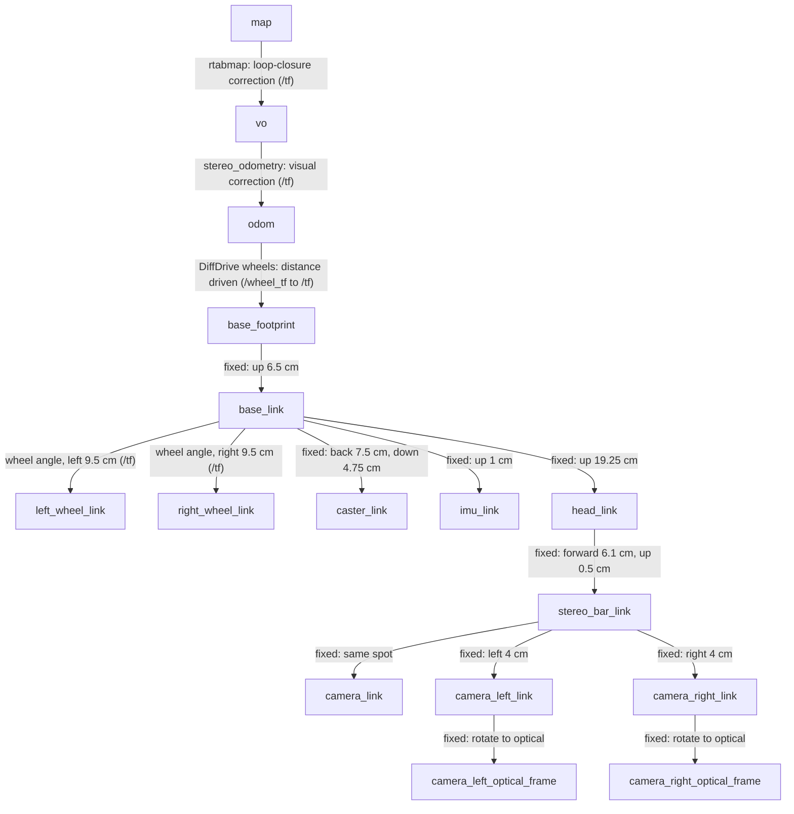

# stereo_eye_launcher

A launch-only ROS 2 package. It starts a **Gazebo Sim (Fortress)** simulation of the
`stereo_eye` robot (from MechaX) inside the `apartment_gazebo` world (from Isekai),
then runs stereo visual odometry and RTAB-Map stereo SLAM.

The repo's `.devcontainer/Dockerfile` is `FROM ros:humble-ros-base` and installs
`ros-humble-ros-gz`, which is built against **Gazebo Fortress** (ign-gazebo 6).
`gz_sim.launch.py` therefore runs `ign gazebo`. Comments and docs in earlier
revisions said "Harmonic"; that was incorrect for this container. The same
`gz_args`, `gz.msgs.*` bridge types, and `gz-sim-*` plugin tags also work on
Harmonic (`ros-humble-ros-gzharmonic`), but Fortress is what this project
actually installs.

```
stereo_eye_launcher/
├── CMakeLists.txt     # ament_cmake, installs launch/ and rviz/ into share/
├── package.xml        # runtime dependencies
├── README.md
├── launch/
│   └── launch.py      # the simulation + RTAB-Map + RViz launch file
└── rviz/
    └── stereo_slam.rviz
```

## Requirements

- ROS 2 Humble with Gazebo Fortress (the default `ros-humble-ros-gz` pairing)
- `ros_gz_sim`, `ros_gz_bridge`, `robot_state_publisher`, `xacro`
- `rtabmap_odom` and `rtabmap_slam` (from `ros-humble-rtabmap-ros`, already in the Dockerfile)
- The `stereo_eye`, `apartment_gazebo`, and `camera_brightness` packages in the same workspace

## Build and run

The repo root is the container workspace `/workspaces/ros2-dev`, and the packages
are already under `src/`. Build and launch from there:

```bash
cd /workspaces/ros2-dev
colcon build --packages-up-to stereo_eye_launcher
source /workspaces/ros2-dev/install/setup.bash
ros2 launch stereo_eye_launcher launch.py
```

Sourcing `/workspaces/ros2-dev/install/setup.bash` is required so
`FindPackageShare` can find the robot and world packages.

## Launch arguments

| Argument       | Default                                         | Meaning                                  |
|----------------|-------------------------------------------------|------------------------------------------|
| `use_sim_time` | `true`                                          | Nodes use the Gazebo `/clock`            |
| `world`        | `<apartment_gazebo share>/worlds/apartment.sdf` | Full path to the world SDF               |
| `x`            | `4.00`                                          | Spawn x position (m)                     |
| `y`            | `5.50`                                          | Spawn y position (m)                     |
| `z`            | `0.05`                                          | Spawn height (m), small drop onto floor  |
| `yaw`          | `0.0`                                           | Spawn heading (rad), faces +X            |
| `rviz`         | `true`                                          | Start RViz2 with `stereo_slam.rviz`      |
| `teleop`       | `true`                                          | Start `teleop_twist_keyboard` in xterm   |
| `render_engine`| `ogre`                                          | Gazebo render engine, `ogre` or `ogre2`  |

Example: `ros2 launch stereo_eye_launcher launch.py x:=3.0 y:=4.5 yaw:=1.57`

**Render engine.** The launch passes `--render-engine <render_engine>` to
`ign gazebo`, which sets the engine for both the Gazebo server (it renders the
camera sensors) and the GUI. The default is `ogre` (Ogre 1.x) because Ogre2
crashes on the WSL D3D12 GPU driver with an Ogre `UnimplementedException` in
`GL3PlusTextureGpu::copyTo`. On a native Linux GPU you can try
`render_engine:=ogre2` for nicer images.

## What launch.py does, step by step

1. **Resolves paths** with `FindPackageShare`: the world
   (`apartment_gazebo/worlds/apartment.sdf`), its models folder, the robot xacro
   (`stereo_eye/urdf/stereo_eye.urdf.xacro`), and `ros_gz_sim`'s `gz_sim.launch.py`.

2. **Sets model paths.** Appends `apartment_gazebo/models` to
   `IGN_GAZEBO_RESOURCE_PATH` (Fortress / `ign gazebo`), `GZ_SIM_RESOURCE_PATH`
   (Harmonic), and `GAZEBO_MODEL_PATH` so the world's `model://` URIs
   (walls, sofa, bed, coffee table, kitchen counter, vanity) resolve.

3. **Starts Gazebo** by including `gz_sim.launch.py` with
   `gz_args = "-r -v 1 <world>"` (`-r` runs immediately, `-v 1` keeps logs quiet)
   and `on_exit_shutdown = true`, so closing Gazebo stops the whole launch.
   On Humble/Fortress this starts `ign gazebo`.

4. **Builds the robot description** by running
   `xacro stereo_eye.urdf.xacro use_gazebo:=true`. The `use_gazebo` flag pulls in
   `stereo_eye.gazebo.xacro`, which adds the gz-sim DiffDrive and
   JointStatePublisher plugins plus the stereo cameras and IMU.

5. **robot_state_publisher** publishes the robot's TF tree from that description,
   using sim time: `base_footprint` → `base_link` → … → `camera_*_optical_frame`.

6. **Spawns the robot** with `ros_gz_sim create`, reading the `robot_description`
   topic, as entity `stereo_eye` at (`x`, `y`, `z`, `yaw`). The default pose is in
   the living room, inside free space x 0.15 to 5.93 m and y 3.58 to 7.85 m, clear of
   the sofa (at 2.4, 7.2) and coffee table (at 2.4, 6.0).

7. **Bridges topics** between Gazebo and ROS with `ros_gz_bridge parameter_bridge`.
   `[` means Gazebo to ROS, `]` means ROS to Gazebo. Every node is launched with
   `use_sim_time` true. DiffDrive's TF (gz topic `/wheel_tf`) is bridged onto
   ROS `/tf` (see TF ownership below). DiffDrive `/odom` is remapped to
   `/wheel_odom` so it does not collide with stereo visual odometry:

   | ROS topic                    | Type                        | Direction     |
   |------------------------------|-----------------------------|---------------|
   | `/clock`                     | `rosgraph_msgs/Clock`       | Gazebo to ROS |
   | `/stereo/left/image_raw`     | `sensor_msgs/Image`         | Gazebo to ROS |
   | `/stereo/left/camera_info`   | `sensor_msgs/CameraInfo`    | Gazebo to ROS |
   | `/stereo/right/image_raw`    | `sensor_msgs/Image`         | Gazebo to ROS |
   | `/stereo/right/camera_info`  | `sensor_msgs/CameraInfo`    | Gazebo to ROS |
   | `/imu`                       | `sensor_msgs/Imu`           | Gazebo to ROS |
   | `/wheel_odom`                | `nav_msgs/Odometry`         | Gazebo to ROS (DiffDrive `/odom`) |
   | `/tf`                        | `tf2_msgs/TFMessage`        | Gazebo to ROS (DiffDrive `/wheel_tf`) |
   | `/joint_states`              | `sensor_msgs/JointState`    | Gazebo to ROS |
   | `/cmd_vel`                   | `geometry_msgs/Twist`       | ROS to Gazebo |

8. **stereo_odometry** (`rtabmap_odom`) and **rtabmap** (`rtabmap_slam`) subscribe
   to the stereo pair with `subscribe_stereo` true, `subscribe_depth` false,
   `frame_id` `base_footprint`, and `Reg/Force3DoF` true. The sim images are
   distortion-free, so they are already rectified: `left/image_rect` and
   `right/image_rect` (and the matching `camera_info` topics) are remapped to
   `/stereo/{left,right}/image_raw` and `/stereo/{left,right}/camera_info`.
   Approximate sync is used (`approx_sync` true, `approx_sync_max_interval`
   0.02 s). Both cameras render in one Sensors-system step, but under load the
   sim slows down and the left, right and `/odom` stamps stop matching exactly,
   so exact sync dropped nearly every frame. Queues are `sync_queue_size` 20
   (the synchronizer) and `topic_queue_size` 10 (each subscriber). rtabmap
   builds its occupancy grid from stereo depth (`Grid/Sensor` 1). rtabmap
   takes `/odom` from stereo_odometry (plus `odom_info`) and waits up to 0.2 s
   for TF.

   stereo_odometry uses the wheel odometry as its starting guess
   (`guess_frame_id` `odom`) and publishes in its own frame `vo`
   (`odom_frame_id` `vo`). It resets itself right after it gets lost
   (`Odom/ResetCountdown` 1). Its visual tuning is modest and explained in the
   comments in `launch.py`: Frame-to-Map strategy (`Odom/Strategy` 0), GFTT/ORB
   features (`Vis/FeatureType` 8), up to 1000 features (`Vis/MaxFeatures`),
   `GFTT/MinDistance` 5 and `Odom/KeyFrameThr` 0.4.

9. **camera_brightness** is remapped from `/image` to `/stereo/left/image_raw`.

## TF ownership

Every frame may have only one parent, so each link above the robot has exactly
one owner:

- **DiffDrive** (Gazebo wheel odometry) publishes `odom` → `base_footprint`. Its gz
  TF topic `/wheel_tf` is bridged onto ROS `/tf`. Its odometry message is on
  `/wheel_odom`.
- **stereo_odometry** publishes `vo` → `odom`, the visual correction on top of the
  wheels (`odom_frame_id` `vo`, `guess_frame_id` `odom`).
- **rtabmap** publishes `map` → `vo`.
- **robot_state_publisher** publishes `base_footprint` → the rest of the robot.

The DiffDrive TF needs MechaX's `tf_topic` `wheel_tf` in `stereo_eye.gazebo.xacro`.
If the xacro still says `tf`, nothing arrives on `/wheel_tf`, stereo_odometry
cannot find `odom` → `base_footprint`, and odometry will not start.

## Frames and the TF tree

This section is for ROS beginners. It explains where the robot's frames come
from, who publishes each one, and how to look at them yourself.

### What a frame is

A **frame** is a coordinate system: an origin point plus three axes, x, y and z.
In RViz the axes are drawn as **red = x**, **green = y**, **blue = z**.

Every part of the robot gets its own frame because every sensor and wheel
measures things from its own point of view. The left camera sees a wall
"2 m ahead of me", the IMU measures acceleration "along my own axes", and a
wheel turns "around its own axle". To combine those measurements, ROS has to
know where each part sits relative to the others.

ROS convention (REP-103) for body frames such as `base_link`: x points forward,
y points left, z points up. Distances are in metres, angles in radians.

### What a transform is

A **transform** between two frames is a **translation** (how far the origin
moved, in x/y/z) plus a **rotation** (how the axes turned). With it you can take
a point written in one frame and rewrite it in the other.

Tiny example with this robot's real numbers. The left camera sees a point
**2 m straight ahead**:

1. In `camera_left_optical_frame` that point is `(0, 0, 2)`, because in an optical
   frame z is "forward" (see below).
2. Undo the optical rotation and it becomes `(2, 0, 0)` in `camera_left_link`
   (x is forward there).
3. `camera_left_link` sits at `(0.061, 0.04, 0.1975)` in `base_link`
   (head 19.25 cm up, bar 6.1 cm forward and 0.5 cm up, left eye 4 cm left).
4. Add that offset and the point is `(2.061, 0.04, 0.1975)` in `base_link`:
   just over 2 m in front of the robot's centre, 4 cm to the left, about 20 cm up.

You never do this maths by hand. The TF library does it for you.

### How TF connects the frames

**TF** (the `tf2` library) is the ROS system that keeps track of all transforms.
Every frame has **exactly one parent**, and each link stores only "where am I
relative to my parent". Because each frame has one parent, the frames form a
**tree**. To convert between any two frames, TF walks the tree from one frame up
to their common ancestor and back down, and chains the transforms on the way.

Transforms travel on two topics:

- `/tf_static` carries transforms that never change (bolted-on parts). They are
  sent once and latched, so late subscribers still get them.
- `/tf` carries transforms that move (wheels, odometry). They are re-sent
  continuously with fresh timestamps.

This is the tree for this robot. Offsets are checked against
`src/stereo_eye/urdf/stereo_eye.urdf.xacro`:



Some notes on the tree:

- `base_footprint` is the point on the floor under the robot. `base_link` sits
  6.5 cm above it, on the wheel axle (6.5 cm is the wheel radius).
- The wheel joints are also rotated by -90° around x, so each wheel's own z axis
  is its axle. That is why a spinning wheel looks like a rotating frame in RViz.
- The caster ball is 7.5 cm behind the axle and its centre is 4.75 cm below
  `base_link`, so it touches the floor.

### Who publishes what

| Link(s) | Publisher | Topic | How |
|---|---|---|---|
| All fixed links (`base_footprint` → `base_link` → head, bar, cameras, IMU, caster) | `robot_state_publisher` | `/tf_static` | Reads the URDF that `xacro` builds from `stereo_eye.urdf.xacro` |
| `base_link` → `left_wheel_link`, `right_wheel_link` | `robot_state_publisher` | `/tf` | Uses the wheel angles in `/joint_states`, bridged from Gazebo |
| `odom` → `base_footprint` | DiffDrive in Gazebo | `/wheel_tf` bridged to `/tf` | Counts wheel turns to estimate how far the robot drove |
| `vo` → `odom` | `stereo_odometry` (rtabmap_odom) | `/tf` | Corrects the wheel estimate using the camera images |
| `map` → `vo` | `rtabmap` (rtabmap_slam) | `/tf` | Drift correction: shifts `vo` when a loop closure shows it has drifted |

**Why are there two odometries?** Both estimate how far the robot has moved,
but they fail in different ways:

- **Wheel odometry** (`odom`) counts wheel turns. It is smooth, never "gets
  lost" and works in the dark, but small errors (slip, wheel size) add up,
  especially when turning.
- **Visual odometry** (`vo`) tracks features between camera frames. It does not
  drift as fast, but it can get lost in front of a plain wall or during a fast
  turn.

So the wheels give stereo_odometry a starting guess for every frame, and
stereo_odometry only publishes the small visual correction on top. If vision
gets lost, the wheels keep `odom` → `base_footprint` moving, and the
auto-reset brings vision back.

Why another layer on top? `vo` is smooth but still slowly drifts. `map` is
globally correct but can jump when rtabmap recognises a place it has seen
before. Keeping them as separate links lets each node own one transform, so
they never fight. See also [TF ownership](#tf-ownership).

**Everything uses sim time.** Every node in this launch runs with
`use_sim_time: true`, so timestamps come from Gazebo's `/clock`, not the wall
clock. If one node used wall time, TF would reject its lookups as "too far in
the future" or "too old", which is why you should not start a bare `rviz2`.

### The optical frame rotation

Cameras and image libraries use a different convention from robot bodies. In an
**optical frame**:

- **z points forward**, out of the lens
- **x points right**, along the image rows
- **y points down**, along the image columns

That matches how pixels are numbered: column grows to the right, row grows
downwards, and depth is "into the picture". Camera drivers, `camera_info` and
the stereo maths all expect this.

So each camera has two frames at the same spot:

- `camera_*_link` follows the robot convention (x forward, y left, z up), which is
  easy to reason about and place in the URDF.
- `camera_*_optical_frame` is the same point, rotated with `rpy = (-90°, 0, -90°)`
  into the optical convention. The images are stamped with this frame
  (`ignition_frame_id` / `gz_frame_id` in `stereo_eye.gazebo.xacro`).

If you stamp images with the wrong one of the two, the point cloud will appear
rotated: a wall in front of the robot will show up as a floor or ceiling.

### Why this matters for stereo

The two cameras are 8 cm apart (the **baseline**, B = 0.08 m), each 4 cm either
side of `stereo_bar_link`. They see the same scene from slightly different
places, so a nearby object appears shifted sideways between the left and right
image. That shift in pixels is the **disparity** (d). Depth follows from it:

$$
Z = \frac{f_x \cdot B}{d}
$$

The cameras are 640x360 at 24 fps with a 1.5 rad horizontal field of view, so
\( f_x = 320 / \tan(0.75) \approx 343.5 \) px and
\( f_x \cdot B \approx 27.48 \) px·m. That is the `-27.48` you see in
`P[3]` of the right camera's `camera_info`. For example:

- an object 1 m away has a disparity of about 27.5 px
- an object 2 m away has a disparity of about 13.7 px
- at 2 m, a 1-pixel matching error changes the depth by about 15 cm

The stereo maths only works if TF knows the exact baseline and that both
cameras are parallel. That is why both cameras hang off one rigid
`stereo_bar_link` with fixed joints. If the TF tree had the wrong offset, every
depth and every odometry step would be wrong by the same factor.

### Try it yourself

With the simulation running (in another terminal, after sourcing
`/workspaces/ros2-dev/install/setup.bash`):

1. Draw the whole tree to a PDF:

   ```bash
   ros2 run tf2_tools view_frames
   ```

   This listens for about 5 seconds and writes `frames_<date>.pdf` (and a `.gv`
   file) in the current folder. Open the PDF to see every frame, its parent,
   who publishes it and how often.

2. Ask TF for one transform:

   ```bash
   ros2 run tf2_ros tf2_echo stereo_bar_link camera_left_link
   ```

   It should print a translation of `[0.000, 0.040, 0.000]` (4 cm to the left)
   and no rotation. Swap in `camera_right_link` and you get `[0.000, -0.040, 0.000]`.
   Try `base_link camera_left_optical_frame` to see the optical rotation as well.

3. Look at it in RViz. The launch file's RViz already has a **TF** display. In
   the Displays panel, expand **TF** and tick **Show Names** (and **Show Axes**)
   to see each frame's name and its red/green/blue axes. Drive with teleop and
   watch the wheel frames spin and `base_footprint` move away from `odom`.

## RViz

Do **not** run a bare `rviz2`. A plain RViz session uses wall time, while every
TF, image, map, and odometry message here is stamped in sim time (`/clock`).
Its default Fixed Frame is also `map`, which does not exist until `rtabmap`
publishes the `map` → `vo` transform, so the view stays empty.

RViz starts automatically with this launch file, using
`rviz/stereo_slam.rviz` and `use_sim_time:=true`. Disable it with
`rviz:=false`:

```bash
ros2 launch stereo_eye_launcher launch.py rviz:=false
```

If you start it manually, load the config and enable sim time:

```bash
rviz2 -d $(ros2 pkg prefix stereo_eye_launcher)/share/stereo_eye_launcher/rviz/stereo_slam.rviz --ros-args -p use_sim_time:=true
```

The config uses Fixed Frame `odom` (wheel odometry, available as soon as the
simulation runs) and these displays:

| Display     | Topic                      | Notes |
|-------------|----------------------------|-------|
| TF          | —                          | Full tree: `odom` → `base_footprint` → cameras; `map` → `vo` → `odom` once SLAM starts |
| RobotModel  | `/robot_description`       | Description Source is Topic, durability Transient Local (matches `robot_state_publisher`) |
| Image       | `/stereo/left/image_raw`   | Reliability Best Effort |
| Image       | `/stereo/right/image_raw`  | Reliability Best Effort |
| Map         | `/map`                     | OccupancyGrid from `rtabmap`; durability Transient Local |
| PointCloud2 | `/cloud_map`               | Assembled 3D map from `rtabmap` |
| Odometry    | `/odom`                    | Stereo visual odometry in frame `vo` (not `/wheel_odom`) |

`/map` and `/cloud_map` are used (not `/rtabmap/map` or `/rtabmap/cloud_map`)
because `launch.py` starts the `rtabmap` node with no namespace and no remaps
for those outputs. On Humble `rtabmap_ros` 0.21+ the node publishes the
relative names `map` (OccupancyGrid) and `cloud_map` (PointCloud2), which
resolve to `/map` and `/cloud_map`. Older ROS 1 names such as `/rtabmap/grid_map`
or `proj_map` do not apply here.

## Teleop

An xterm window running `teleop_twist_keyboard` opens automatically and
publishes `geometry_msgs/Twist` on `/cmd_vel`, which the ros_gz_bridge
forwards to Gazebo. Click that window first, then use the keys it prints
(`i`/`j`/`l`/`k` and so on) to drive the robot.

Disable it with `teleop:=false`:

```bash
ros2 launch stereo_eye_launcher launch.py teleop:=false
```

Or run it in a separate terminal (useful if xterm is not available):

```bash
ros2 run teleop_twist_keyboard teleop_twist_keyboard
```

## Saving logs

To keep a copy of everything a launch prints, start the simulation with the run
script instead of calling `ros2 launch` yourself. From `/workspaces/ros2-dev`:

```bash
cd /workspaces/ros2-dev
./src/stereo_eye_launcher/scripts/run_sim.sh
```

Launch arguments pass straight through, for example
`./src/stereo_eye_launcher/scripts/run_sim.sh rviz:=false teleop:=false`.
The output still shows on screen as usual.

The files end up in `/workspaces/ros2-dev/src/stereo_eye_launcher/logs/`:

- `launch_<YYYY-mm-dd_HH-MM-SS>.log` holds the full screen output of that run
  (stdout and stderr), one new file per run.
- Each node's own ROS log files land there too, because the script sets
  `ROS_LOG_DIR` to this folder.

The script finds `logs/` relative to its own location and creates it if it is
missing. The logs are plain text and are not gitignored, so you can commit one
or attach it when asking for help with debugging.

## Quick checks after launch

```bash
ros2 topic list
ros2 topic hz /stereo/left/image_raw
ros2 topic hz /odom          # visual odometry (frame vo)
ros2 topic hz /wheel_odom    # wheel odometry from Gazebo
ros2 run tf2_ros tf2_echo odom base_footprint   # wheels, needs /wheel_tf bridged
ros2 topic echo --once /stereo/right/camera_info --field p   # expect P[3] = -27.48
ros2 run tf2_ros tf2_echo map base_footprint
```

Do not start a bare `rviz2` from this list. Use the launch file's RViz node, or
see the RViz section below if you need to start it by hand.

## Troubleshooting

**Visual odometry gets lost and the map freezes.** Signs are
`Not enough inliers 0/20` and `quality=0` from `stereo_odometry`, followed by
`no odometry is provided, image ignored` from `rtabmap`. The launch sets
`Odom/ResetCountdown` to `1`, so `stereo_odometry` resets itself on the next
frame after it gets lost. `rtabmap` then starts a new map session and joins it
to the old map through loop closure when the robot sees a known place again.

To reset odometry by hand:

```bash
ros2 service call /reset_odom std_srvs/srv/Empty
```

Tip: turn slowly, especially in front of plain walls. Fast turns change the view
too much between frames, so the stereo matcher finds no features in common.

## Known limitations

- **Topic prefixes.** Topic names in the robot xacro are relative. If Gazebo publishes
  them under a prefix (for example `/model/stereo_eye/...`), check with
  `gz topic -l` (or `ign topic -l` on Fortress) and update the bridge arguments
  in `launch.py`.
- **Plain walls.** Untextured surfaces give stereo matching few features, so visual
  odometry and loop closures can be weak until the world has more visual texture.
- Not built or run on real ROS in the environment that last edited this package.
  The launch file compiles and `package.xml` parses; a full `colcon` build and
  Gazebo launch was not verified here.
