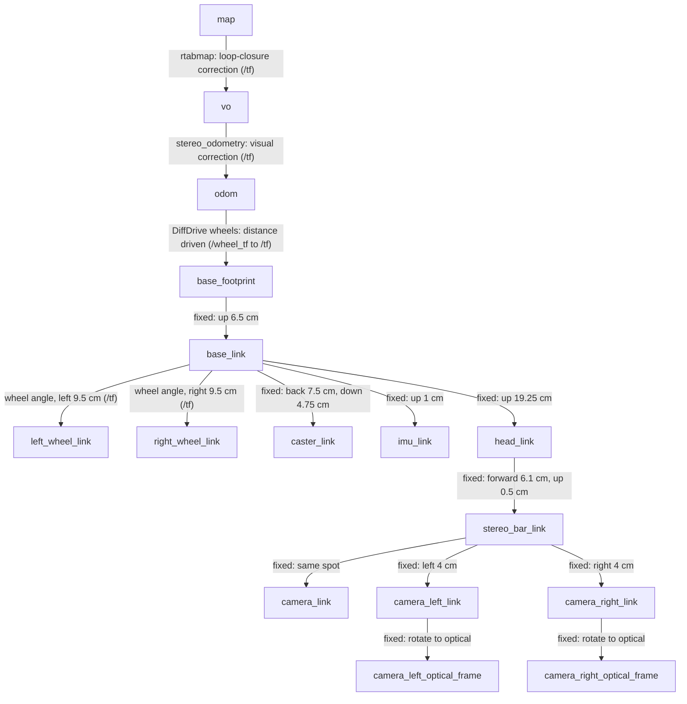

# stereo_eye_launcher

A launch-only ROS 2 package. It starts a **Gazebo Sim (Fortress)** simulation of the
`stereo_eye` robot (from MechaX) inside the `apartment_gazebo` world (from Isekai),
then runs stereo visual odometry and RTAB-Map stereo SLAM.

The repo's `.devcontainer/Dockerfile` is `FROM ros:humble-ros-base` and installs
`ros-humble-ros-gz`, which is built against **Gazebo Fortress** (ign-gazebo 6).
`gz_sim.launch.py` therefore runs `ign gazebo`. Comments and docs in earlier
revisions said "Harmonic"; that was incorrect for this container. The same
`gz_args`, `gz.msgs.*` bridge types, and `gz-sim-*` plugin tags also work on
Harmonic (`ros-humble-ros-gzharmonic`), but Fortress is what this project
actually installs.

```
stereo_eye_launcher/
├── CMakeLists.txt     # ament_cmake, installs launch/, rviz/, config/, behavior_trees/ and the helper scripts
├── package.xml        # runtime dependencies
├── README.md
├── behavior_trees/
│   └── explore_navigate_to_pose.xml  # Nav2 behaviour tree for explore:=true
├── config/
│   ├── nav2_params.yaml     # Nav2 settings for explore:=true
│   └── explore_params.yaml  # explore_lite settings for explore:=true
├── launch/
│   └── launch.py      # the simulation + RTAB-Map + RViz launch file
├── maps/              # explore:=true saves finished maps here
├── rviz/
│   └── stereo_slam.rviz
└── scripts/
    ├── run_sim.sh            # source the workspace and launch; also saves logs/latest.log
    ├── explore_map_saver.py  # saves the map when exploration is done
    └── stuck_recovery.py     # backs up when the robot is stuck
```

## Requirements

- ROS 2 Humble with Gazebo Fortress (the default `ros-humble-ros-gz` pairing)
- `ros_gz_sim`, `ros_gz_bridge`, `robot_state_publisher`, `xacro`
- `rtabmap_odom` and `rtabmap_slam` (from `ros-humble-rtabmap-ros`, already in the Dockerfile)
- `rqt_robot_steering` (`ros-humble-rqt-robot-steering`) for driving with the mouse
- `teleop_twist_keyboard` and `xterm`, only if you use `teleop:=true`
- The `stereo_eye`, `apartment_gazebo`, and `camera_brightness` packages in the same workspace
- Only for `explore:=true`: Nav2 and explore_lite, see
  [Autonomous exploration](#autonomous-exploration-exploretrue)

## Build and run

The repo root is the container workspace `/workspaces/ros2-dev`, and the packages
are already under `src/`. Build and launch from there:

```bash
cd /workspaces/ros2-dev
colcon build --packages-up-to stereo_eye_launcher
source /workspaces/ros2-dev/install/setup.bash
ros2 launch stereo_eye_launcher launch.py
```

Sourcing `/workspaces/ros2-dev/install/setup.bash` is required so
`FindPackageShare` can find the robot and world packages.

Or use the run script, which sources the workspace and launches in one go
(all output stays in the terminal):

```bash
./src/stereo_eye_launcher/scripts/run_sim.sh
```

### First run, step by step

1. Build and start the simulation as above. Gazebo, RViz and a small
   **Robot Steering** window open.
2. Wait until the camera images show up in RViz (a few seconds).
3. Drive slowly with the steering sliders, at about 0.15 m/s and 0.4 rad/s
   (see [Driving the robot](#driving-the-robot)).
4. Watch the grey occupancy map and the point cloud grow in RViz as the robot
   sees more of the apartment.
5. To stop, press Ctrl+C in the terminal where you started the launch.
   Closing the Gazebo window also stops everything.

## Launch arguments

| Argument       | Default                                         | Meaning                                  |
|----------------|-------------------------------------------------|------------------------------------------|
| `use_sim_time` | `true`                                          | Nodes use the Gazebo `/clock`            |
| `world`        | `<apartment_gazebo share>/worlds/apartment.sdf` | Full path to the world SDF               |
| `x`            | `4.00`                                          | Spawn x position (m)                     |
| `y`            | `5.50`                                          | Spawn y position (m)                     |
| `z`            | `0.05`                                          | Spawn height (m), small drop onto floor  |
| `yaw`          | `0.0`                                           | Spawn heading (rad), faces +X            |
| `rviz`         | `true`                                          | Start RViz2 with `stereo_slam.rviz`      |
| `steering`     | `true`                                          | Start `rqt_robot_steering` (mouse sliders) |
| `teleop`       | `false`                                         | Start `teleop_twist_keyboard` in xterm   |
| `render_engine`| `ogre`                                          | Gazebo render engine, `ogre` or `ogre2`  |
| `gz_gui`       | `true`                                          | Open the Gazebo window; `false` = server only (sensors still render, RViz still works) |
| `explore`      | `false`                                         | Explore by itself (Nav2 + explore_lite) and save the map; turns off `steering` and `teleop` |
| `explorer`     | `explore_lite`                                  | Who picks the frontiers with `explore:=true`: `explore_lite` (as before) or `own` (`frontier_explorer.py`, see "Our own explorer") |
| `maps_dir`     | `/workspaces/ros2-dev/src/stereo_eye_launcher/maps` | Where `explore:=true` saves the map |
| `map_name`     | `apartment`                                     | File name prefix of the saved map        |

Example: `ros2 launch stereo_eye_launcher launch.py x:=3.0 y:=4.5 yaw:=1.57`

**Render engine.** The launch passes `--render-engine <render_engine>` to
`ign gazebo`, which sets the engine for both the Gazebo server (it renders the
camera sensors) and the GUI. The default is `ogre` (Ogre 1.x) because Ogre2
crashes on the WSL D3D12 GPU driver with an Ogre `UnimplementedException` in
`GL3PlusTextureGpu::copyTo`. On a native Linux GPU you can try
`render_engine:=ogre2` for nicer images.

## What launch.py does, step by step

1. **Resolves paths** with `FindPackageShare`: the world
   (`apartment_gazebo/worlds/apartment.sdf`), its models folder, the robot xacro
   (`stereo_eye/urdf/stereo_eye.urdf.xacro`), and `ros_gz_sim`'s `gz_sim.launch.py`.

2. **Sets model paths.** Appends `apartment_gazebo/models` to
   `IGN_GAZEBO_RESOURCE_PATH` (Fortress / `ign gazebo`), `GZ_SIM_RESOURCE_PATH`
   (Harmonic), and `GAZEBO_MODEL_PATH` so the world's `model://` URIs
   (walls, sofa, bed, coffee table, kitchen counter, vanity) resolve.

3. **Starts Gazebo** by including `gz_sim.launch.py` with
   `gz_args = "-r -v 1 <world>"` (`-r` runs immediately, `-v 1` keeps Gazebo's messages short)
   and `on_exit_shutdown = true`, so closing Gazebo stops the whole launch.
   With `gz_gui:=false`, `-s` is added in front (server only, no window);
   then the launch stops when the Gazebo server stops.
   On Humble/Fortress this starts `ign gazebo`.

4. **Builds the robot description** by running
   `xacro stereo_eye.urdf.xacro use_gazebo:=true`. The `use_gazebo` flag pulls in
   `stereo_eye.gazebo.xacro`, which adds the gz-sim DiffDrive and
   JointStatePublisher plugins plus the stereo cameras and IMU.

5. **robot_state_publisher** publishes the robot's TF tree from that description,
   using sim time: `base_footprint` → `base_link` → … → `camera_*_optical_frame`.

6. **Spawns the robot** with `ros_gz_sim create`, reading the `robot_description`
   topic, as entity `stereo_eye` at (`x`, `y`, `z`, `yaw`). The default pose is in
   the living room, inside free space x 0.15 to 5.93 m and y 3.58 to 7.85 m, clear of
   the sofa (at 2.4, 7.2) and coffee table (at 2.4, 6.0).

7. **Bridges topics** between Gazebo and ROS with `ros_gz_bridge parameter_bridge`.
   `[` means Gazebo to ROS, `]` means ROS to Gazebo. Every node is launched with
   `use_sim_time` true. DiffDrive's TF (gz topic `/wheel_tf`) is bridged onto
   ROS `/tf` (see TF ownership below). DiffDrive `/odom` is remapped to
   `/wheel_odom` so it does not collide with stereo visual odometry:

   | ROS topic                    | Type                        | Direction     |
   |------------------------------|-----------------------------|---------------|
   | `/clock`                     | `rosgraph_msgs/Clock`       | Gazebo to ROS |
   | `/stereo/left/image_raw`     | `sensor_msgs/Image`         | Gazebo to ROS |
   | `/stereo/left/camera_info`   | `sensor_msgs/CameraInfo`    | Gazebo to ROS |
   | `/stereo/right/image_raw`    | `sensor_msgs/Image`         | Gazebo to ROS |
   | `/stereo/right/camera_info`  | `sensor_msgs/CameraInfo`    | Gazebo to ROS |
   | `/imu`                       | `sensor_msgs/Imu`           | Gazebo to ROS |
   | `/wheel_odom`                | `nav_msgs/Odometry`         | Gazebo to ROS (DiffDrive `/odom`) |
   | `/tf`                        | `tf2_msgs/TFMessage`        | Gazebo to ROS (DiffDrive `/wheel_tf`) |
   | `/joint_states`              | `sensor_msgs/JointState`    | Gazebo to ROS |
   | `/cmd_vel`                   | `geometry_msgs/Twist`       | ROS to Gazebo |

8. **stereo_odometry** (`rtabmap_odom`) and **rtabmap** (`rtabmap_slam`) subscribe
   to the stereo pair with `subscribe_stereo` true, `subscribe_depth` false,
   `frame_id` `base_footprint`, and `Reg/Force3DoF` true. The sim images are
   distortion-free, so they are already rectified: `left/image_rect` and
   `right/image_rect` (and the matching `camera_info` topics) are remapped to
   `/stereo/{left,right}/image_raw` and `/stereo/{left,right}/camera_info`.
   Approximate sync is used (`approx_sync` true, `approx_sync_max_interval`
   0.02 s). Both cameras render in one Sensors-system step, but under load the
   sim slows down and the left, right and `/odom` stamps stop matching exactly,
   so exact sync dropped nearly every frame. Queues are `sync_queue_size` 20
   (the synchronizer) and `topic_queue_size` 10 (each subscriber). rtabmap
   builds its occupancy grid from stereo depth (`Grid/Sensor` 1). rtabmap
   takes `/odom` from stereo_odometry (plus `odom_info`) and waits up to 0.2 s
   for TF.

   stereo_odometry uses the wheel odometry as its starting guess
   (`guess_frame_id` `odom`) and publishes in its own frame `vo`
   (`odom_frame_id` `vo`). It resets itself right after it gets lost
   (`Odom/ResetCountdown` 1). Its visual tuning is modest and explained in the
   comments in `launch.py`: Frame-to-Map strategy (`Odom/Strategy` 0), GFTT/ORB
   features (`Vis/FeatureType` 8), up to 1000 features (`Vis/MaxFeatures`),
   `GFTT/MinDistance` 5 and `Odom/KeyFrameThr` 0.4.

9. **camera_brightness** is remapped from `/image` to `/stereo/left/image_raw`.

## TF ownership

Every frame may have only one parent, so each link above the robot has exactly
one owner:

- **DiffDrive** (Gazebo wheel odometry) publishes `odom` → `base_footprint`. Its gz
  TF topic `/wheel_tf` is bridged onto ROS `/tf`. Its odometry message is on
  `/wheel_odom`.
- **stereo_odometry** publishes `vo` → `odom`, the visual correction on top of the
  wheels (`odom_frame_id` `vo`, `guess_frame_id` `odom`).
- **rtabmap** publishes `map` → `vo`.
- **robot_state_publisher** publishes `base_footprint` → the rest of the robot.

The DiffDrive TF needs MechaX's `tf_topic` `wheel_tf` in `stereo_eye.gazebo.xacro`.
If the xacro still says `tf`, nothing arrives on `/wheel_tf`, stereo_odometry
cannot find `odom` → `base_footprint`, and odometry will not start.

## Frames and the TF tree

This section is for ROS beginners. It explains where the robot's frames come
from, who publishes each one, and how to look at them yourself.

### What a frame is

A **frame** is a coordinate system: an origin point plus three axes, x, y and z.
In RViz the axes are drawn as **red = x**, **green = y**, **blue = z**.

Every part of the robot gets its own frame because every sensor and wheel
measures things from its own point of view. The left camera sees a wall
"2 m ahead of me", the IMU measures acceleration "along my own axes", and a
wheel turns "around its own axle". To combine those measurements, ROS has to
know where each part sits relative to the others.

ROS convention (REP-103) for body frames such as `base_link`: x points forward,
y points left, z points up. Distances are in metres, angles in radians.

### What a transform is

A **transform** between two frames is a **translation** (how far the origin
moved, in x/y/z) plus a **rotation** (how the axes turned). With it you can take
a point written in one frame and rewrite it in the other.

Tiny example with this robot's real numbers. The left camera sees a point
**2 m straight ahead**:

1. In `camera_left_optical_frame` that point is `(0, 0, 2)`, because in an optical
   frame z is "forward" (see below).
2. Undo the optical rotation and it becomes `(2, 0, 0)` in `camera_left_link`
   (x is forward there).
3. `camera_left_link` sits at `(0.061, 0.04, 0.1975)` in `base_link`
   (head 19.25 cm up, bar 6.1 cm forward and 0.5 cm up, left eye 4 cm left).
4. Add that offset and the point is `(2.061, 0.04, 0.1975)` in `base_link`:
   just over 2 m in front of the robot's centre, 4 cm to the left, about 20 cm up.

You never do this maths by hand. The TF library does it for you.

### How TF connects the frames

**TF** (the `tf2` library) is the ROS system that keeps track of all transforms.
Every frame has **exactly one parent**, and each link stores only "where am I
relative to my parent". Because each frame has one parent, the frames form a
**tree**. To convert between any two frames, TF walks the tree from one frame up
to their common ancestor and back down, and chains the transforms on the way.

Transforms travel on two topics:

- `/tf_static` carries transforms that never change (bolted-on parts). They are
  sent once and latched, so late subscribers still get them.
- `/tf` carries transforms that move (wheels, odometry). They are re-sent
  continuously with fresh timestamps.

This is the tree for this robot. Offsets are checked against
`src/stereo_eye/urdf/stereo_eye.urdf.xacro`:



Some notes on the tree:

- `base_footprint` is the point on the floor under the robot. `base_link` sits
  6.5 cm above it, on the wheel axle (6.5 cm is the wheel radius).
- The wheel joints are also rotated by -90° around x, so each wheel's own z axis
  is its axle. That is why a spinning wheel looks like a rotating frame in RViz.
- The caster ball is 7.5 cm behind the axle and its centre is 4.75 cm below
  `base_link`, so it touches the floor.

### Who publishes what

| Link(s) | Publisher | Topic | How |
|---|---|---|---|
| All fixed links (`base_footprint` → `base_link` → head, bar, cameras, IMU, caster) | `robot_state_publisher` | `/tf_static` | Reads the URDF that `xacro` builds from `stereo_eye.urdf.xacro` |
| `base_link` → `left_wheel_link`, `right_wheel_link` | `robot_state_publisher` | `/tf` | Uses the wheel angles in `/joint_states`, bridged from Gazebo |
| `odom` → `base_footprint` | DiffDrive in Gazebo | `/wheel_tf` bridged to `/tf` | Counts wheel turns to estimate how far the robot drove |
| `vo` → `odom` | `stereo_odometry` (rtabmap_odom) | `/tf` | Corrects the wheel estimate using the camera images |
| `map` → `vo` | `rtabmap` (rtabmap_slam) | `/tf` | Drift correction: shifts `vo` when a loop closure shows it has drifted |

**Why are there two odometries?** Both estimate how far the robot has moved,
but they fail in different ways:

- **Wheel odometry** (`odom`) counts wheel turns. It is smooth, never "gets
  lost" and works in the dark, but small errors (slip, wheel size) add up,
  especially when turning.
- **Visual odometry** (`vo`) tracks features between camera frames. It does not
  drift as fast, but it can get lost in front of a plain wall or during a fast
  turn.

So the wheels give stereo_odometry a starting guess for every frame, and
stereo_odometry only publishes the small visual correction on top. If vision
gets lost, the wheels keep `odom` → `base_footprint` moving, and the
auto-reset brings vision back.

Why another layer on top? `vo` is smooth but still slowly drifts. `map` is
globally correct but can jump when rtabmap recognises a place it has seen
before. Keeping them as separate links lets each node own one transform, so
they never fight. See also [TF ownership](#tf-ownership).

**Everything uses sim time.** Every node in this launch runs with
`use_sim_time: true`, so timestamps come from Gazebo's `/clock`, not the wall
clock. If one node used wall time, TF would reject its lookups as "too far in
the future" or "too old", which is why you should not start a bare `rviz2`.

### The optical frame rotation

Cameras and image libraries use a different convention from robot bodies. In an
**optical frame**:

- **z points forward**, out of the lens
- **x points right**, along the image rows
- **y points down**, along the image columns

That matches how pixels are numbered: column grows to the right, row grows
downwards, and depth is "into the picture". Camera drivers, `camera_info` and
the stereo maths all expect this.

So each camera has two frames at the same spot:

- `camera_*_link` follows the robot convention (x forward, y left, z up), which is
  easy to reason about and place in the URDF.
- `camera_*_optical_frame` is the same point, rotated with `rpy = (-90°, 0, -90°)`
  into the optical convention. The images are stamped with this frame
  (`ignition_frame_id` / `gz_frame_id` in `stereo_eye.gazebo.xacro`).

If you stamp images with the wrong one of the two, the point cloud will appear
rotated: a wall in front of the robot will show up as a floor or ceiling.

### Why this matters for stereo

The two cameras are 8 cm apart (the **baseline**, B = 0.08 m), each 4 cm either
side of `stereo_bar_link`. They see the same scene from slightly different
places, so a nearby object appears shifted sideways between the left and right
image. That shift in pixels is the **disparity** (d). Depth follows from it:

$$
Z = \frac{f_x \cdot B}{d}
$$

The cameras are 640x360 at 24 fps with a 1.5 rad horizontal field of view, so
\( f_x = 320 / \tan(0.75) \approx 343.5 \) px and
\( f_x \cdot B \approx 27.48 \) px·m. That is the `-27.48` you see in
`P[3]` of the right camera's `camera_info`. For example:

- an object 1 m away has a disparity of about 27.5 px
- an object 2 m away has a disparity of about 13.7 px
- at 2 m, a 1-pixel matching error changes the depth by about 15 cm

The stereo maths only works if TF knows the exact baseline and that both
cameras are parallel. That is why both cameras hang off one rigid
`stereo_bar_link` with fixed joints. If the TF tree had the wrong offset, every
depth and every odometry step would be wrong by the same factor.

### Try it yourself

With the simulation running (in another terminal, after sourcing
`/workspaces/ros2-dev/install/setup.bash`):

1. Draw the whole tree to a PDF:

   ```bash
   ros2 run tf2_tools view_frames
   ```

   This listens for about 5 seconds and writes `frames_<date>.pdf` (and a `.gv`
   file) in the current folder. Open the PDF to see every frame, its parent,
   who publishes it and how often.

2. Ask TF for one transform:

   ```bash
   ros2 run tf2_ros tf2_echo stereo_bar_link camera_left_link
   ```

   It should print a translation of `[0.000, 0.040, 0.000]` (4 cm to the left)
   and no rotation. Swap in `camera_right_link` and you get `[0.000, -0.040, 0.000]`.
   Try `base_link camera_left_optical_frame` to see the optical rotation as well.

3. Look at it in RViz. The launch file's RViz already has a **TF** display. In
   the Displays panel, expand **TF** and tick **Show Names** (and **Show Axes**)
   to see each frame's name and its red/green/blue axes. Drive with the
   steering sliders and watch the wheel frames spin and `base_footprint` move
   away from `odom`.

## RViz

Do **not** run a bare `rviz2`. A plain RViz session uses wall time, while every
TF, image, map, and odometry message here is stamped in sim time (`/clock`).
Its default Fixed Frame is also `map`, which does not exist until `rtabmap`
publishes the `map` → `vo` transform, so the view stays empty.

RViz starts automatically with this launch file, using
`rviz/stereo_slam.rviz` and `use_sim_time:=true`. Disable it with
`rviz:=false`:

```bash
ros2 launch stereo_eye_launcher launch.py rviz:=false
```

If you start it manually, load the config and enable sim time:

```bash
rviz2 -d $(ros2 pkg prefix stereo_eye_launcher)/share/stereo_eye_launcher/rviz/stereo_slam.rviz --ros-args -p use_sim_time:=true
```

The config uses Fixed Frame `odom` (wheel odometry, available as soon as the
simulation runs) and these displays:

| Display     | Topic                      | Notes |
|-------------|----------------------------|-------|
| TF          | —                          | Full tree: `odom` → `base_footprint` → cameras; `map` → `vo` → `odom` once SLAM starts |
| RobotModel  | `/robot_description`       | Description Source is Topic, durability Transient Local (matches `robot_state_publisher`) |
| Image       | `/stereo/left/image_raw`   | Reliability Best Effort |
| Image       | `/stereo/right/image_raw`  | Reliability Best Effort |
| Map         | `/map`                     | OccupancyGrid from `rtabmap`; durability Transient Local |
| PointCloud2 | `/cloud_map`               | Assembled 3D map from `rtabmap` |
| Odometry    | `/odom`                    | Stereo visual odometry in frame `vo` (not `/wheel_odom`) |

`/map` and `/cloud_map` are used (not `/rtabmap/map` or `/rtabmap/cloud_map`)
because `launch.py` starts the `rtabmap` node with no namespace and no remaps
for those outputs. On Humble `rtabmap_ros` 0.21+ the node publishes the
relative names `map` (OccupancyGrid) and `cloud_map` (PointCloud2), which
resolve to `/map` and `/cloud_map`. Older ROS 1 names such as `/rtabmap/grid_map`
or `proj_map` do not apply here.

## Driving the robot

Drive slowly. Visual odometry needs consecutive camera frames to overlap, so
the recommended speeds are **0.15 m/s** forward and **0.4 rad/s** turning.
Faster turns, especially in front of plain walls, are the most common reason
odometry gets lost.

**Mouse sliders (default).** A small **Robot Steering** window
(`rqt_robot_steering`) opens with the launch. Drag the top slider to drive
forward or back and the bottom slider to turn, and press **stop** to halt.
It publishes `geometry_msgs/Twist` on `/cmd_vel`, which the ros_gz_bridge
forwards to Gazebo. It does not need keyboard focus, so it keeps working after
you click RViz or Gazebo. The sliders are capped at the recommended speeds;
you can raise the limits in the window's number boxes. If the window shows
another topic, type `/cmd_vel` in its topic box.

**Keyboard (optional).** Start `teleop_twist_keyboard` in an xterm with
`teleop:=true`:

```bash
ros2 launch stereo_eye_launcher launch.py teleop:=true
```

It only reads keys while its xterm window has keyboard focus. Clicking RViz or
Gazebo takes the focus away, so click the xterm again before pressing
`i`/`j`/`l`/`k` and so on. It starts at 0.15 m/s and 0.4 rad/s; avoid the keys
that raise the speed (`q`, `w`, `e`).

To run either one by hand in a separate terminal:

```bash
ros2 run rqt_robot_steering rqt_robot_steering
ros2 run teleop_twist_keyboard teleop_twist_keyboard --ros-args -p speed:=0.15 -p turn:=0.4
```

## Where the output goes

Everything the launch prints (Gazebo, rtabmap, Nav2, explore_lite, the map
saver) shows up in the terminal where you started it, with colours, as
before. When you start it with `run_sim.sh`, the same text is **also saved**
as plain text (without colour codes) to

```
<repo>/logs/latest.log      this run, overwritten every time you start
<repo>/logs/previous.log    the run before (moved there at start)
```

`<repo>` is the top folder of the git repository (in the container
`/workspaces/ros2-dev`). Only these two files are ever written; the `logs/`
folder is ignored by git. `run_sim.sh` prints `Saving this run's output to
...` at the start and `Output saved to ...` at the end. Press Ctrl+C to stop
as usual; the last lines of the shutdown still end up in the file.

Launch arguments pass straight through `run_sim.sh`, for example
`./src/stereo_eye_launcher/scripts/run_sim.sh rviz:=false steering:=false`.
Started with plain `ros2 launch stereo_eye_launcher launch.py`, nothing is
saved; then scroll up in the terminal and copy the text.

To check the script after editing it (prints nothing if it is fine):

```bash
bash -n src/stereo_eye_launcher/scripts/run_sim.sh
```

## Quick checks after launch

```bash
ros2 topic list
ros2 topic hz /stereo/left/image_raw
ros2 topic hz /odom          # visual odometry (frame vo)
ros2 topic hz /wheel_odom    # wheel odometry from Gazebo
ros2 run tf2_ros tf2_echo odom base_footprint   # wheels, needs /wheel_tf bridged
ros2 topic echo --once /stereo/right/camera_info --field p   # expect P[3] = -27.48
ros2 run tf2_ros tf2_echo map base_footprint
```

Do not start a bare `rviz2` from this list. Use the launch file's RViz node, or
see the RViz section below if you need to start it by hand.

## Troubleshooting

**Visual odometry gets lost and the map freezes.** Signs are
`Not enough inliers 0/20` and `quality=0` from `stereo_odometry`, followed by
`no odometry is provided, image ignored` from `rtabmap`. The launch sets
`Odom/ResetCountdown` to `1`, so `stereo_odometry` resets itself on the next
frame after it gets lost. It restarts from where it was plus the wheel
motion, and `publish_null_when_lost` is `false`, so `rtabmap` keeps adding to
the same map (see "The explored map disappears" below).

To reset odometry by hand (note: this one restarts at the origin, so rtabmap
does start a new map, and the old one is hidden until a loop closure joins
them):

```bash
ros2 service call /reset_odom std_srvs/srv/Empty
```

Tip: turn slowly, especially in front of plain walls. Fast turns change the view
too much between frames, so the stereo matcher finds no features in common.

**The explored map disappears in RViz (and comes back later, or not).**
Cause: when visual odometry got lost and reset itself, `stereo_odometry`
used to tell `rtabmap` "odometry restarted" (covariance 9999 on `/odom`).
`rtabmap` then started a brand-new map session, printing `Odometry is reset
(identity pose or high variance ...) Increment map id!`. The old map is still
in memory, but `/map` only shows the current session, so the map seemed to
vanish, and Nav2's costmap and explore_lite's frontiers shrank with it. The
old part only came back after a loop closure. Fix (already in `launch.py`):
`publish_null_when_lost: false` on `stereo_odometry`. Together with the wheel
odometry guess, a reset now continues from the last pose, so there is only
one map. If you still see `Increment map id!`, someone called `/reset_odom`
or the TF tree broke; restart the launch for a clean map.
It is not an RViz setting: the Map display already uses Reliable + Transient
Local, which matches rtabmap's latched `/map`.

**Warning `Lookup would require extrapolation into the future` for
`odom` -> `base_footprint` (about 60 ms).** The wheel position from Gazebo
(`/wheel_tf`, sent 50 times a second) arrives a little after the camera
images, so for a moment there is no wheel position yet for the newest image.
`stereo_odometry` and `rtabmap` wait up to 0.2 s (`wait_for_transform`) and
Nav2 accepts 0.5 s (`transform_tolerance`), so an occasional warning is
harmless. If it repeats several times per second, the simulation is running
slowly (check the real-time factor at the bottom right of Gazebo; close other
programs or use `rviz:=false`). Publishing the wheel odometry faster
(`odom_publish_frequency` in `stereo_eye.gazebo.xacro`) would also shrink the
gap.

**Everything shuts down with `D3D12: Removing Device` or `Out of memory`.**
On WSL the Gazebo window shares a small amount of GPU memory with the camera
sensors, and when it runs out Gazebo crashes and takes the whole launch with
it. Try, in this order:

1. Start without the Gazebo window:
   `./src/stereo_eye_launcher/scripts/run_sim.sh gz_gui:=false`.
   The simulation, the cameras and the ToF sensor still run, and RViz still
   shows the robot, the images and the map. You only lose the Gazebo window.
2. Free the GPU memory: close the terminals, then in **Windows PowerShell** run
   `wsl --shutdown`, wait a few seconds, open the container again and restart
   the launch.

**The map is stuck and does not recover.** First drive slowly towards a place
with more detail (furniture, corners) for a few seconds. If the map still does
not grow, restart the launch (Ctrl+C, then start it again). rtabmap starts with
`-d`, which deletes the old map database, so every launch begins with a fresh
map.

**The robot tipped over or got stuck in furniture.** The simplest fix is to
restart the launch. To put the robot back without restarting, Gazebo's
`set_pose` service moves it to the default spawn pose:

```bash
ign service -s /world/apartment/set_pose \
  --reqtype ignition.msgs.Pose --reptype ignition.msgs.Boolean --timeout 3000 \
  --req 'name: "stereo_eye", position: {x: 4.0, y: 5.5, z: 0.05}, orientation: {w: 1}'
```

Moving the robot this way is a "teleport" that neither odometry saw, so the
current map will no longer line up. Restart the launch if you want a clean map.
Resetting the whole world also works on Gazebo versions that support it:

```bash
ign service -s /world/apartment/control \
  --reqtype ignition.msgs.WorldControl --reptype ignition.msgs.Boolean --timeout 3000 \
  --req 'reset: {all: true}'
```

If the simulation is paused afterwards, press the play button in Gazebo.

**Where do I see what went wrong?** Everything prints in the terminal where
you started the launch. Scroll up to find the first red or yellow line (errors
and warnings). With `run_sim.sh` the whole output is also in
`logs/latest.log` (the run before in `logs/previous.log`); send that file
when asking for help. See [Where the output goes](#where-the-output-goes).

## Autonomous exploration (explore:=true)

### What frontier exploration is

Instead of you driving with the sliders, the robot drives itself until it has
mapped every room it can reach.

The map has three kinds of cells: **free** (seen, nothing there), **occupied**
(a wall or furniture) and **unknown** (not seen yet). A **frontier** is the
border between free and unknown space, for example an open doorway or the
edge of what the cameras have seen so far. The idea is simple:

1. Find all frontiers in the current map.
2. Pick a good one (close and large).
3. Drive there. The cameras see new space, the map grows, the frontier moves.
4. Repeat until no frontiers are left. Then the map is complete.

Three parts do this together:

- **rtabmap** builds the 2D map on `/map` from the stereo cameras (as before).
- **explore_lite** (`m-explore-ros2`) finds frontiers and picks the next goal.
- **Nav2** plans a path to that goal and drives the robot along it, slowly
  (0.15 m/s, 0.4 rad/s), around walls and furniture.

When explore_lite finds no more frontiers, `explore_map_saver.py` saves the map.

### Install

Nav2 comes from apt; the Dockerfile has it commented out:

```bash
sudo apt install ros-humble-navigation2 ros-humble-nav2-bringup
```

explore_lite has **no apt package for Humble** (it is not in the ROS Humble
release list), so it is built from source in the workspace. The source repo
<https://github.com/robo-friends/m-explore-ros2> is a **git submodule** at
`src/third_party/m-explore-ros2`, pinned to a fixed commit. Our repo only stores
a link to it, not the code. It contains `explore_lite` and `explore_lite_msgs`
(which we use) plus `multirobot_map_merge`, which `colcon_defaults.yaml` skips.

Download it once (and again whenever the pinned commit changes). Run this on
**Windows** in the repo folder, because git inside the container may be blocked
by the company network:

```bash
git submodule update --init
```

The normal build then includes it, because `stereo_eye_launcher` depends on it:

```bash
cd /workspaces/ros2-dev
colcon build --packages-up-to stereo_eye_launcher
source install/setup.bash
```

### Run it

```bash
cd /workspaces/ros2-dev
./src/stereo_eye_launcher/scripts/run_sim.sh explore:=true
```

(or `ros2 launch stereo_eye_launcher launch.py explore:=true`). Then wait.
Nothing happens for the first 10 to 30 seconds while Gazebo, rtabmap and
Nav2 start up; after that the robot starts moving by itself.

With `explore:=true` the **Robot Steering** window and the keyboard teleop do
**not** start, even if you pass `steering:=true` or `teleop:=true`. The
steering window sends `/cmd_vel` all the time (zero when the sliders are in
the middle) and would fight Nav2 for the wheels. To drive by hand again, stop
the launch and start it without `explore:=true`.

How the drive commands flow: Nav2's controller sends `cmd_vel_nav`, the
velocity smoother limits it to 0.15 m/s and 0.4 rad/s and sends `/cmd_vel`,
and the ros_gz_bridge passes `/cmd_vel` to the robot in Gazebo, the same topic
the steering window uses.

### What you see in RViz

- **Map** (grey): rtabmap's 2D map, growing as the robot moves.
- **Frontiers**: explore_lite's markers. Blue dots are frontier edges, red dots
  are frontiers it gave up on, green spheres mark the centre of each frontier
  (bigger = more attractive).
- **Plan** (green line): the path Nav2 is following to the current frontier.
- **Global Costmap** (off by default; tick it in the Displays panel): the map
  as Nav2 sees it, with a coloured safety margin around walls.
- **Obstacle Cloud** (small dots, off by default): the live stereo points Nav2
  uses to see walls and furniture (`/stereo/obstacle_cloud`).

### How the robot avoids walls

**Live obstacles.** Besides rtabmap's map, Nav2 now also looks at a live
point cloud computed from the two camera images (node
`stereo_obstacle_cloud`, rtabmap_util `point_cloud_xyzrgb`). Points between
10 cm and 40 cm above the floor and up to 2.5 m away are marked as obstacles
in both costmaps right away, without waiting for rtabmap's map update. Floor
points are used to erase old obstacles that are no longer there.
Points lower than 10 cm are ignored on purpose: stereo depth on the floor next
to walls is noisy, and those stray points used to show up as fake obstacles
around the robot, which made it hesitate. Low things right in front of the
robot are caught by the ToF sensor instead (its beam is 5.5 cm high).

**The blind zone.** Stereo depth works by finding the same spot in the left
and the right image. Very close to the cameras (closer than about 0.35 m in
front of them, worse on plain walls) the two images differ too much and
nothing is measured, so a wall that close is invisible. That is why:

- obstacles seen from further away are **kept** in the costmap while the robot
  gets closer,
- the front ToF sensor covers exactly that zone (below),
- the path follower checks about 1 s ahead and **stops** when the robot would
  touch an obstacle,
- Nav2's recoveries no longer wipe obstacles within 0.75 m of the robot.

**Front ToF sensor.** MechaX's front time-of-flight range sensor (Gazebo
`gpu_lidar`, topic `/front_tof`, `sensor_msgs/msg/LaserScan`, range 1.0 m,
50 degrees wide, 21 x 3 rays at 5.5 cm height) looks ahead, also right inside
the stereo blind zone. `launch.py` bridges
it to ROS. It is used twice:

- **0.04 to 1.0 m:** Nav2's local costmap marks what it sees as an obstacle,
  so the robot slows down and steers away. The global costmap (the one the
  path planner uses) marks it too, so a new path goes around it. Every hit
  is **kept for 20 s** (`observation_persistence`), even when the stereo
  cloud would erase it. This matters for plain furniture, see below. It now
  also sees walls ahead and door frames, but the simulated sensor has no
  noise, so it marks them exactly where they are (the same place as the map),
  which does not make doors narrower.
- **closer than 0.04 m while driving forward** (the nose is practically
  touching): the stuck recovery (below) fires at once and backs up
  (`tof_too_close_m`, default 0.04 m).

**Plain furniture (one-colour boxes).** The furniture in apartment_gazebo
(bed, sofa, coffee table, kitchen counter, vanity) is plain boxes in one
colour without a texture. Stereo depth needs texture: on a flat one-colour
face the left and right images look the same everywhere, so no depth is
measured there. Only the box's vertical edges against the textured wall
behind it give a few points, and most of those are removed as "lonely
points" by the cloud's noise filter. So the boxes are almost missing from
rtabmap's map and from the stereo obstacles (in RViz: only a few red
speckles and thin arcs where the furniture is). What reliably sees them is
the ToF sensor (its beam at 5.5 cm hits every box). That is why its hits are
kept for 20 s and also go into the planner's costmap: once the robot has
touched a box face, Nav2 plans around it instead of straight through it
again. It notices a box up to 1.0 m ahead and 25 degrees to either side, but
only at 5.5 cm height; the real fix
is texture on the furniture in the world (asked for from apartment_gazebo).

Readings of exactly the sensor's smallest range (`range_min`, 0.01 m since
MechaX's update; it was 0.02 m) are ignored: Gazebo turns any too-small value
into exactly that number instead of a real distance. In Kunal's test the
sensor reported 0.02 m (the old `range_min`) all the time, even after the robot had backed away and turned, which caused the
endless back-up loop.

**Stuck recovery.** If the robot still gets too close or ends up pushing into
something, the `stuck_recovery` node notices it. It only watches while
explore_lite is exploring; once exploration is complete or paused it leaves
the robot alone. It reacts when one of these happens:

- the front ToF sensor measures something closer than 4 cm while Nav2 drives
  the robot forward (immediately; this is the main trigger). Standing or
  turning next to a wall does not count, or
- as a careful backup: Nav2 has asked the robot to drive **forward** at
  0.08 m/s or more, without a break, for 5 s, while the camera-based position
  (visual odometry) moved less than 5 cm. At that speed it should have moved
  at least 40 cm. The wheels are not trusted for this, because they keep
  turning when they slip, or
- the robot has stood for 3 s so close to a wall that Nav2 cannot plan a path
  from there (its centre is within 0.15 m of a wall in the costmap). Then it
  moves 0.15 m forward or back, whichever side is clearer, and keeps the same
  frontier (`[NO PATH]`).

Turning on the spot, slowing down or pausing for a moment never counts as
stuck, so hesitating can no longer make the robot reverse.

It then:

1. stops at once and prints for example `[TOO CLOSE] Something is 3.0 cm in
   front of the robot while driving at (x, y): backing up 0.15 m and choosing
   another frontier`,
2. tells explore_lite to give up that frontier (it turns red in RViz),
3. backs up 0.15 m slowly, **without turning**,
4. lets exploration continue (`[STUCK] Recovery done, exploration continues.`).
   Nav2 then plans a new path and turns the robot towards it by itself.

After a recovery it waits 10 s before it reacts again. If it fires again
within 0.5 m of an earlier recovery (in the last 2 minutes), the message says
`(repeat 1 here)`, it backs up further (up to 0.3 m) and waits twice as long
(up to 40 s), so it cannot loop at one spot. All numbers are parameters of the
node; see the top of `scripts/stuck_recovery.py`.

### Why it no longer rocks back and forth

Earlier versions backed up and turned 90 degrees, first one way, then the
other, again and again. Kunal's log showed where that came from:

- The turning and reversing came from `stuck_recovery`, not from Nav2: the
  log had `[TOO CLOSE] Something is 2 cm in front of the robot` at 600.9 s
  and again at 623.8 s, right after its 10 s pause ended, and no Nav2 spin or
  back-up at all.
- Both readings were exactly 0.02 m, the sensor's smallest value, and the
  second came after the robot had already backed up 0.2 m and turned. That
  is a fake reading (see the ToF sensor above), now ignored.
- Exploration had already ended (no new goals from explore_lite in the
  log, and "Recovery done." without "exploration continues"), yet the robot
  kept reacting. Now it is left alone when exploration is not running.
- The recovery turned 90 degrees alternately left and right. It now only
  backs up and lets Nav2 choose the direction.
- Nav2's own recoveries also spun 90 degrees and backed up 0.3 m whenever a
  path failed. The exploration tree now only clears the costmaps and waits
  2 s, then gives up so explore_lite tries another frontier.
- explore_lite re-chose its goal every 5 s, and after the switch to 2.5 cm
  cells it valued distance only half as much, so it liked far-away
  frontiers and switched between them. It now re-chooses every 10 s and
  prefers near frontiers more strongly (`potential_scale` 10), see
  `config/explore_params.yaml`.

To check the ToF sensor, drive the robot towards a wall by hand (without
`explore:=true`) and run `ros2 topic echo /front_tof --field ranges`: the
numbers drop below 1.0 as the wall gets close, and show `inf` when nothing is
in range. The smallest number it can show is its `range_min` (0.01 m); that
must stay below `tof_too_close_m` (0.04 m), or the 4 cm trigger can never
fire. If the topic changes, set the `stuck_recovery` parameter
`tof_topic` (and the `front_tof` source in `config/nav2_params.yaml`).

### Why the robot fits through doors

Nav2 thinks of the robot as a **circle**, and keeps that circle out of
walls. Earlier it used a 0.25 m radius (a guessed 0.15 m body plus 0.10 m
extra), so for Nav2 the robot was 0.5 m wide, and doors and gaps under
0.6 m were "closed". Now the numbers come from MechaX's robot model
(`src/stereo_eye/urdf/stereo_eye.urdf.xacro`):

| Part of the robot             | Distance from the centre |
|-------------------------------|--------------------------|
| Head with its round ends      | 0.128 m to each side (the widest part) |
| Wheels                        | 0.112 m to each side     |
| Front (ToF housing)           | 0.116 m ahead            |
| Back (rear caster)            | 0.097 m behind           |

So the robot is 0.256 m wide and almost round. Nav2's circle is now
**0.15 m** (`robot_radius`): the real 0.128 m plus about 2 cm.

Instead of a big hard margin there is now a soft one, the **inflation**: the
closer a cell is to a wall, the more "expensive" it is, so the planner prefers
the middle of a gap but may still use a narrow one. The cost is

`cost = 252 x e^(-6 x (distance to the wall - 0.15 m))`, and 0 beyond 0.35 m.

Example, a door 0.356 m wide (robot width + 10 cm):

| Where in the door              | Distance to the nearer side | Cost |
|--------------------------------|-----------------------------|------|
| exactly in the middle          | 0.178 m                     | 213  |
| 2.5 cm off the middle          | 0.153 m                     | 247  |
| 3 cm or more off the middle    | under 0.15 m                | 253 = "would touch", not allowed |

253 and above means "blocked", so the middle (213) is open and is the
cheapest line through the door, which is the one the planner takes.

**Why the map cells are smaller now.** The map and the costmaps are made of
square cells. With 5 cm cells, a 0.356 m door usually shows up as only six
free cells (0.30 m), because the cells rarely line up with the door frame, and
then it is too narrow. The cells are now **2.5 cm** (rtabmap `Grid/CellSize`
and the costmaps' `resolution`), and the door is open in every position. The
saved map files have 2.5 cm pixels as a result.

**Driving more decisively.** The path follower (Regulated Pure Pursuit) was
also loosened:

- it turns on the spot only when the path is more than 60 degrees to the side
  (was 45); otherwise it drives on a curve,
- it looks 0.45 m ahead on the path (was 0.4), which gives smoother driving,
- it slows down near obstacles only within 0.25 m (was 0.4 m), and never goes
  slower than 0.08 m/s while driving (was 0.05),
- it looks 1 s ahead for collisions (was 1.5 s), so one fake point further away
  no longer freezes it,
- a goal counts as reached within 0.30 m (was 0.25), and Nav2 gives up on a
  goal after 10 s without moving 10 cm (was 15 s), so explore_lite picks
  another frontier sooner.

### Where the map is saved

When explore_lite reports that exploration is complete, the map is saved to

```
/workspaces/ros2-dev/src/stereo_eye_launcher/maps/apartment_<YYYY-mm-dd_HH-MM-SS>.pgm
/workspaces/ros2-dev/src/stereo_eye_launcher/maps/apartment_<YYYY-mm-dd_HH-MM-SS>.yaml
```

The `.pgm` is the picture (white = free, black = wall, grey = unknown) and
the `.yaml` says how big a pixel is (0.025 m) and where the map's corner sits.
Change the folder or prefix with `maps_dir:=...` and `map_name:=...`. The
terminal prints `Map saved: ...` when it is done.

How "done" is detected: explore_lite publishes its state on `/explore/status`
(`explore_lite_msgs/msg/ExploreStatus`). When it finds no frontiers left, it
prints `No frontiers found, stopping.` or `All frontiers traversed/tried out,
stopping.` and publishes `exploration_complete`. `explore_map_saver.py` waits
for exactly that message, then runs `map_saver_cli`. One exception: a
"complete" in the first 60 s, or while the map knows less than 4 m² (only the
cameras' first view), is a false alarm at start-up. Then it prints
`[EXPLORE] Map still tiny (... m2 known after ... s), looking around and
restarting exploration (try 1 of 3)`, turns the robot once on the spot (about
20 s) so the cameras see the room, and restarts explore_lite
(`[EXPLORE] Restarting exploration`). After 3 such tries it saves the map
anyway. You can watch the status with:

```bash
ros2 topic echo /explore/status
```

### Save the map by hand

You can save the current map at any time, also during exploration or
without `explore:=true`, from a second terminal:

```bash
source /workspaces/ros2-dev/install/setup.bash
ros2 run nav2_map_server map_saver_cli -t /map \
  -f /workspaces/ros2-dev/src/stereo_eye_launcher/maps/apartment_manual \
  --ros-args -p save_map_timeout:=10.0
```

### If it stops or gets stuck

**Nothing moves at all.** Check the terminal for `Waiting for costmap to
become available` (explore_lite) or `Timed out waiting for transform`
(Nav2). Both mean the `map` frame is not there yet: rtabmap has not started
mapping. Check that the camera images show up in RViz and that
`ros2 run tf2_ros tf2_echo map base_footprint` prints a pose.

**The robot is stuck against furniture or turning on the spot.** Nav2 first
tries its recoveries (clear the costmaps, wait 2 s; no spinning or backing
up any more). If Nav2 gives up (the robot moved less than 10 cm in 10 s) or
explore_lite sees no progress for 30 s, that frontier is put on a blacklist (it turns red) and explore_lite picks
another one. If it is truly wedged, put it back with the
`set_pose` command in [Troubleshooting](#troubleshooting), and expect the map
to be off afterwards.

**The robot sits still and the terminal repeats "Goal succeeded".** Before
the fix, explore_lite sometimes picked a frontier whose centre was right next
to the robot (for example at a wall the cameras cannot see). The goal was
"reached" at once (closer than 0.25 m), the frontier stayed, and the same goal
was sent again every quarter of a second, forever. Now Nav2 uses
`behavior_trees/explore_navigate_to_pose.xml`, which refuses goals closer than
0.35 m (`goal_reached_tol`). The goal then fails instead of succeeding, and
explore_lite blacklists that frontier (red in RViz) and moves on. In the
terminal you will see `Goal failed` now and then; that is expected. If the
robot still stands still for minutes, pause and resume exploration:

```bash
ros2 topic pub --once /explore/resume std_msgs/msg/Bool "{data: false}"
ros2 topic pub --once /explore/resume std_msgs/msg/Bool "{data: true}"
```

**The robot drives into a wall and keeps pushing.** It should now stop in
front of walls (live obstacle layer) and, if it still pushes, `[STUCK]`
messages appear and it backs up by itself. If not:

- Check the obstacle cloud: `ros2 topic hz /stereo/obstacle_cloud` should show
  about 24 Hz. Tick **Obstacle Cloud** in RViz: walls in front of the robot
  should be covered with dots. Plain walls without texture give few dots.
- Check that the stuck watchdog runs: the terminal shows `Watching for a stuck
  robot` at start-up.
- Check the front ToF sensor: `ros2 topic hz /front_tof` should show messages
  (about 20 Hz). If there are none, the robot model does not have the sensor
  (MechaX) and only the slow 5 s "pushing without moving" check protects the
  robot.
- If `[STUCK]` or `[TOO CLOSE]` shows `(repeat 2 here)` or more, the robot is
  boxed in; stop the launch, move it with `set_pose` (see
  [Troubleshooting](#troubleshooting)) and start again.

**The robot still backs up again and again, or takes long to move on.**
Please send `logs/latest.log`, or at least the lines that contain any of
these words: `[STUCK]`, `[TOO CLOSE]`, `[NO PATH]`, `Running spin`,
`Running backup`, `Failed to make progress`, `planner failed`,
`Received goal preemption request`, `No frontiers found`,
`All frontiers traversed`. To pick them out:

```bash
grep -E "STUCK|TOO CLOSE|NO PATH|Running spin|Running backup|Failed to make progress|planner failed|preemption|frontiers" logs/latest.log
```

Also check the ToF sensor with the robot standing in open space:
`ros2 topic echo /front_tof --field ranges` should print `inf` for all 63
numbers (21 x 3 rays) if nothing is within 1 m. If it prints `0.01` (its `range_min`), the sensor gives fake readings (MechaX's model);
they are ignored now, but then the sensor is blind and only the stereo
cameras protect the front.

**The robot stops too far from walls or refuses to go through a door.** This
was tuned (see [Why the robot fits through doors](#why-the-robot-fits-through-doors)):
openings from about 0.36 m (robot width + 10 cm) should now be passable. If
one is still refused:

- Tick **Global Costmap** in RViz and look at the door. If a dark (lethal)
  spot sits in the gap, it is a fake obstacle from noisy stereo points; it is
  erased when the robot sees the floor behind it. If the walls of the door
  look thick or doubled in the grey map, the map is the problem (stereo depth
  gets blurry far away): drive closer, or lower `Grid/RangeMax` in `launch.py`.
- If the robot hesitates in front of the gap and then gives up, the terminal
  shows `Failed to make progress` (10 s without moving 10 cm) or
  `collision ahead`. Both make explore_lite try another frontier, which is
  fine; it often comes back to the door from a better angle.
- If RViz shows a fan of arrows around the robot: that is just the Odometry
  display's history (it now keeps only 1 arrow), not the controller.

**Visual odometry got lost.** Signs are `Not enough inliers` from
`stereo_odometry` and a map that stops growing. Odometry resets itself on the
next frame and continues from the last position, so the map stays one piece;
it may shift a little. The robot then usually continues. If the map is badly
broken, stop and start again.

**The robot turns once on the spot right after start.** That is expected:
explore_lite often finds no frontier in the very first camera view and says
"No frontiers found" within a second. The map saver notices that
(`[EXPLORE] Map still tiny ...`), turns the robot a full circle so the map
grows, and restarts exploration. If you see `try 3 of 3` followed by
`saving it anyway`, the cameras did not build a map while turning: check
`/map` in RViz and the `stereo_odometry` lines (`quality=0` means it is lost).

**Nav2 never drives: every goal fails with "extrapolation into the future".**
The terminal shows, again and again with *the same* numbers:

```text
[controller_server]: Exception in transformPose: Lookup would require extrapolation
  into the future.  Requested time 1.660000 but the latest data is at time 1.600000,
  when looking up transform from frame [odom] to frame [map]
[controller_server]: Unable to transform robot pose into global plan's frame
[controller_server]: Controller patience exceeded
```

Paths are planned, but the robot does not move. Numbers that never change
while the simulation runs mean that Nav2's TF has frozen: it stopped taking in
new transforms a second or two after start. TF itself is fine
(`ros2 run tf2_ros tf2_echo map odom` shows the time going up). Another sign:
on Ctrl+C, `planner_server` and `controller_server` "failed to terminate" and
get killed. The cause is a bug in the installed tf2 version **0.25.23**
(Humble update of September 2026): two threads in the costmap lock each other
out for good (fixed in 0.25.24, ros2/geometry2 #990). `run_sim.sh` warns at
start if it finds that version. Check and fix inside the container:

```bash
dpkg -l 'ros-humble-tf2*' | grep 0.25.23   # any line here = affected
sudo apt update && sudo apt install --only-upgrade 'ros-humble-tf2*'
```

Changing `transform_tolerance` does not help: it only says how long to wait
for a transform, and a frozen TF never delivers one.

**Exploration ends too early ("No frontiers found").** This happens when the
map is still small, or when the frontiers left are smaller than
`min_frontier_size` (0.3 m in `config/explore_params.yaml`; it was 0.75 m for
one version, which stopped exploration right at start-up), or when every
frontier got blacklisted (`All frontiers traversed/tried out`). A map is saved
anyway (except at start-up, see above). To continue exploring, resume explore_lite:

```bash
ros2 topic pub --once /explore/resume std_msgs/msg/Bool "{data: true}"
```

Each time it finishes again a new, time-stamped map is saved. To pause
exploration, publish `{data: false}` on the same topic.

**It keeps going for a long time.** Small frontiers behind furniture or in
noisy corners can keep it busy. Save the map by hand (above) whenever it looks
good enough, then stop the launch.

### Our own explorer (explorer:=own, opt-in)

`scripts/frontier_explorer.py` can replace explore_lite. It is off by default
(`explorer:=explore_lite`); try it with:

```bash
./src/stereo_eye_launcher/scripts/run_sim.sh explore:=true explorer:=own gz_gui:=false
```

It uses the same topics as explore_lite (`/explore/status`, `/explore/resume`,
the `navigate_to_pose` action), so the map saver and `stuck_recovery.py` work
the same way. What it does differently (lessons from the 2026-11-24 run, where
explore_lite sent the robot to "frontiers" outside the building):

1. **Only reachable frontiers.** A gap counts as a way through only if it is
   at least 0.36 m wide (robot + 5 cm per side). A frontier must be visible
   from where the robot can drive, never behind a wall.
2. **Ranked by path length**, not straight-line distance, minus a bonus for
   long frontiers.
3. **The goal is a free cell near the frontier**, at least ~0.27 m from walls,
   never the frontier's centre (which can be inside a wall).
4. **Failed areas are blacklisted** (0.5 m around the goal) for 60 s, 120 s,
   then for good.
5. **Looks around first** (one turn on the spot) until 10 m2 of map is known.
6. **Sticks to its goal** until it is reached, fails, makes no progress for
   30 s, or another frontier is clearly better.
7. **Escape:** two failed goals in a row without moving: it asks
   `stuck_recovery.py` to back up 0.15 m and turn ~45 deg (`[ESCAPE]` in the
   log). Only `stuck_recovery.py` ever drives backwards.
8. **Every decision is logged** with `[EXPLORER]`: which frontier, its size,
   the path length, the score and why it was chosen, and why others were not.

Settings: `config/frontier_explorer_params.yaml` (every value is explained
there). Check the frontier choice without ROS, on a synthetic map or on a
saved map:

```bash
python3 src/stereo_eye_launcher/test/test_frontier_selection.py
python3 src/stereo_eye_launcher/test/test_frontier_selection.py \
    --map src/stereo_eye_launcher/maps/<saved map>.yaml --robot 0 0
```

### Limitations

- **Stereo blind zone.** Nothing closer than about 0.35 m in front of the
  cameras is seen, and nothing behind or beside the robot. Obstacles that
  appear inside that zone (or were never seen from further away) are only
  caught by the front ToF sensor (50 degrees ahead, 1.0 m, at 5.5 cm height) or the stuck
  check.
- **ToF only looks ahead** (25 degrees to each side, one height). A corner
  or table leg further to the side is missed; then only the slow "pushing
  without moving" check (5 s) helps.
- **Low obstacles and table tops.** The map only counts things between 5 cm
  and 40 cm high (`Grid/MaxGroundHeight`, `Grid/MaxObstacleHeight`), and the
  live stereo obstacles only things between 10 cm and 40 cm. Very low objects
  are missed unless they are straight ahead (ToF); the robot may drive under
  tables.
- **Tight clearance.** Nav2 now keeps only about 2 cm between the robot's
  widest part (the head) and a wall, plus the soft inflation cost. If the map
  is a few centimetres off (drift), the robot can brush a door frame; the ToF
  trigger and the stuck check then back it out.
- **Plain walls and fast turns** still make visual odometry weak, which can
  bend or double walls in the map.
- **Untested.** Nav2, explore_lite and the map saver were written against the
  Humble sources but not run here (no ROS on the machine that edited this).
  The files compile and parse; check the first real run carefully.

## Known limitations

- **Topic prefixes.** Topic names in the robot xacro are relative. If Gazebo publishes
  them under a prefix (for example `/model/stereo_eye/...`), check with
  `gz topic -l` (or `ign topic -l` on Fortress) and update the bridge arguments
  in `launch.py`.
- **Plain walls.** Untextured surfaces give stereo matching few features, so visual
  odometry and loop closures can be weak until the world has more visual texture.
- Not built or run on real ROS in the environment that last edited this package.
  The launch file compiles and `package.xml` parses; a full `colcon` build and
  Gazebo launch was not verified here.
